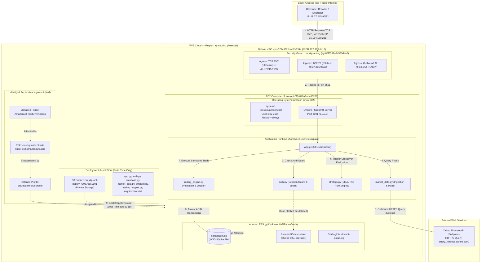
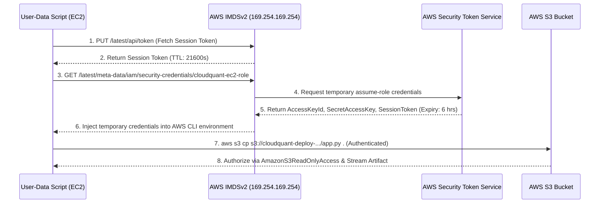

# CLOUDQUANT — MASTER TECHNICAL KNOWLEDGE & VIVA EXAMINATION GUIDE

> **Academic Context**: B.Tech in Computer Science & Engineering, SRM Institute of Science and Technology, Chennai.  
> **Coursework**: FT-III Cloud Computing.  
> **Project Title**: CloudQuant — Cloud-Based Algorithmic Trading & Portfolio Management System.  
> **Audit Status**: Post-Deployment Audit & Hardening Complete. Verified against live AWS infrastructure (`ap-south-1`) and local repository codebase.

---

## TABLE OF CONTENTS
1. [Executive Summary & Project Overview](#1-executive-summary--project-overview)
2. [End-to-End System Architecture & Data Flows](#2-end-to-end-system-architecture--data-flows)
3. [Deep-Dive Cloud Computing & AWS Infrastructure (65% Weight)](#3-deep-dive-cloud-computing--aws-infrastructure)
   - 3.1 [Cloud Service Models: IaaS vs PaaS vs SaaS](#31-cloud-service-models-iaas-vs-paas-vs-saas)
   - 3.2 [Virtualization & Hardware Abstraction (AWS Nitro)](#32-virtualization--hardware-abstraction-aws-nitro)
   - 3.3 [Compute: Amazon EC2 (`t3.micro` & Amazon Linux 2023)](#33-compute-amazon-ec2-t3micro--amazon-linux-2023)
   - 3.4 [Storage Architecture: Block (EBS gp3) vs Object (S3)](#34-storage-architecture-block-ebs-gp3-vs-object-s3)
   - 3.5 [Identity & Access Management (IAM Roles, Instance Profiles, IMDS)](#35-identity--access-management-iam-roles-instance-profiles-imds)
   - 3.6 [Virtual Private Cloud (VPC), Subnets & Internet Gateway](#36-virtual-private-cloud-vpc-subnets--internet-gateway)
   - 3.7 [Stateful Firewalling: Security Groups vs Stateless NACLs](#37-stateful-firewalling-security-groups-vs-stateless-nacls)
   - 3.8 [Networking Protocols, IP Addressing & Ports (TCP/HTTP/WebSockets)](#38-networking-protocols-ip-addressing--ports-tcphttpwebsockets)
   - 3.9 [High Availability, Fault Tolerance & Regions/AZs](#39-high-availability-fault-tolerance--regionsazs)
4. [Deployment Automation & Linux System Internals](#4-deployment-automation--linux-system-internals)
   - 4.1 [Chronological Step-by-Step Deployment History](#41-chronological-step-by-step-deployment-history)
   - 4.2 [Bootstrap Mechanism: `user-data` & `cloud-init`](#42-bootstrap-mechanism-user-data--cloud-init)
   - 4.3 [Process Supervision: systemd Service Architecture](#43-process-supervision-systemd-service-architecture)
   - 4.4 [Post-Deployment Incidents & Resolution Mechanics](#44-post-deployment-incidents--resolution-mechanics)
5. [Application Security & Authentication Engineering](#5-application-security--authentication-engineering)
   - 5.1 [Authentication Architecture: Session State & Access Guards](#51-authentication-architecture-session-state--access-guards)
   - 5.2 [Cryptographic Password Verification: bcrypt Internals](#52-cryptographic-password-verification-bcrypt-internals)
   - 5.3 [Secrets Management (`secrets.toml`, Linux Permissions, Fail-Closed Design)](#53-secrets-management-secretstoml-linux-permissions-fail-closed-design)
   - 5.4 [Brute-Force Mitigation & Constant-Time Validation](#54-brute-force-mitigation--constant-time-validation)
   - 5.5 [Verified Security Controls vs Production Limitations (Honest Disclosure)](#55-verified-security-controls-vs-production-limitations-honest-disclosure)
6. [Application Logic & Codebase Walkthrough](#6-application-logic--codebase-walkthrough)
   - 6.1 [Codebase Organization & File Topology](#61-codebase-organization--file-topology)
   - 6.2 [User Interface Orchestration (`app.py`)](#62-user-interface-orchestration-apppy)
   - 6.3 [Market Data Ingestion & Synthetic Fallback (`market_data.py`)](#63-market-data-ingestion--synthetic-fallback-market_datapy)
   - 6.4 [Technical Strategy Engine: SMA & RSI (`strategy.py`)](#64-technical-strategy-engine-sma--rsi-strategypy)
   - 6.5 [Trading Engine & Risk Management (`trading_engine.py`)](#65-trading-engine--risk-management-trading_enginepy)
   - 6.6 [Persistence Layer & Relational Schema (`database.py`)](#66-persistence-layer--relational-schema-databasepy)
   - 6.7 [Interactive Credential Provisioning (`setup_auth.py`)](#67-interactive-credential-provisioning-setup_authpy)
7. [Testing, Verification & Quantitative Evaluation](#7-testing-verification--quantitative-evaluation)
8. [Architectural Trade-offs & Cloud Economics](#8-architectural-trade-offs--cloud-economics)
9. [18-Slide Presentation (PPT) Discrepancy Matrix](#9-18-slide-presentation-ppt-discrepancy-matrix)
10. [Comprehensive Faculty Viva Voce Q&A (45 Master Questions)](#10-comprehensive-faculty-viva-voce-qa-45-master-questions)

---

## 1. EXECUTIVE SUMMARY & PROJECT OVERVIEW

### 1.1 Academic Intent & Context
CloudQuant was conceived and developed as a capstone laboratory demonstration for the **FT-III Cloud Computing** curriculum in Computer Science & Engineering at SRM Institute of Science and Technology. The core pedagogical problem it solves is **eliminating local compute dependency** in quantitative financial operations. Traditional algorithmic trading workflows rely on developer workstations running local Python scripts, presenting severe points of failure: hardware sleep modes, unmonitored crashes, local power outages, dynamic residential ISP drops, and lack of standardized remote auditability.

CloudQuant transposes this operational workflow into an **Infrastructure-as-a-Service (IaaS)** paradigm on Amazon Web Services (AWS), running continuously within an Amazon Elastic Compute Cloud (EC2) virtualized container in the Mumbai region (`ap-south-1`).

### 1.2 Core Capabilities
1. **Cloud-Hosted Persistent Service**: Runs an automated 24/7 web application managed by Linux systemd, independent of client workstation availability.
2. **Deterministic & External Market Data Acquisition**: Uses `yfinance` to query daily equity price series for key National Stock Exchange (NSE) tickers (`RELIANCE.NS`, `TCS.NS`, `INFY.NS`, `HDFCBANK.NS`), paired with an offline pseudo-random synthetic generator for zero-latency demonstration resilience.
3. **Automated Indicator Computation**: Computes dual Simple Moving Averages (10-day Fast SMA, 30-day Slow SMA) and the 14-day Relative Strength Index (RSI) using vectorized Pandas/NumPy pipelines.
4. **Algorithmic Signal Formulation**: Evaluates momentum crossovers filtered by bound-checked RSI indicators to emit deterministic `BUY`, `SELL`, or `HOLD` advisories accompanied by human-readable execution rationales.
5. **Rigorous Paper-Trading Execution Engine**: Simulates transaction fulfillment at verified closing prices, maintaining double-entry virtual cash ledgers, average cost bases, unrealized/realized Profit and Loss (P&L), and preventing unauthorized overselling or capital overdrafts.
6. **Zero-Trust Administrative Guard**: Enforces an integrated application-level login gateway backed by high-entropy bcrypt password hashing, session state persistence, session-scoped brute-force lockouts, and strictly partitioned Linux configuration files.

### 1.3 Scope Boundaries & Disclaimers
- **Strictly Simulated (Paper Trading)**: CloudQuant maintains zero connectivity with SEBI-registered brokers, clearing corporations, banking gateways, or financial exchange FIX/REST endpoints. Capital amounts are synthetic SQLite ledger entries.
- **Single-Tenant Prototype**: Designed as an isolated academic demonstration prototype; not an enterprise multi-tenant software-as-a-service application.

---

## 2. END-TO-END SYSTEM ARCHITECTURE & DATA FLOWS

### 2.1 Architectural Topology Diagram
The system architecture isolates deployment-time dependencies from runtime infrastructure.



### 2.2 Component Interaction Matrix

| Tier | Component Name | Technical Classification | Runtime State | Primary Dependency | Downstream Dependents |
| :--- | :--- | :--- | :--- | :--- | :--- |
| **Client** | Web Browser | Client / Presentation | Active Client | Network Route to `35.154.180.231` | Uvicorn / Streamlit |
| **Network** | `cloudquant-sg` | Stateful Virtual Firewall | Active (Kernel) | AWS VPC Routing Tables | EC2 Network Interface (ENI) |
| **Compute** | `i-0f6c849a8ad486260` | Hardware Virtual Machine (IaaS) | Active (Running) | Xen/Nitro Hypervisor Cluster | All application processes |
| **Process** | `cloudquant.service` | Linux daemon (systemd) | Active (Running) | Python 3.11 binary (`/usr/bin/`) | Python Streamlit Runtime |
| **Web Svc** | Streamlit / Uvicorn | Python Web Application Server | Listening `:8501` | `app.py`, `auth.py` | Client WebSocket Connection |
| **Security** | `auth.py` | Application Layer Guard | Invoked Per-Run | `secrets.toml`, Python `bcrypt` | `app.py` UI rendering |
| **Data Engine**| `trading_engine.py` | Transaction Logic Controller | In-Memory Object | `database.py`, SQLite connection | SQLite disk file |
| **Storage** | Amazon EBS (`gp3`) | High-durability Block Volume | Mounted `/` | AWS Storage Subsystem SAN | Operating System, SQLite, App |
| **Deploy** | Amazon S3 Bucket | Object Store (Deployment Artifacts)| Passive Storage | IAM Instance Profile | User-Data Bootstrap Script |
| **Identity**| `cloudquant-ec2-role` | Security Token Issuer | On-Demand (IMDS)| AWS STS Service | AWS CLI inside EC2 |

---

## 3. DEEP-DIVE CLOUD COMPUTING & AWS INFRASTRUCTURE

> **Pedagogical Note for Viva Preparation**: This section accounts for ~65% of the conceptual difficulty in cloud coursework examinations. Faculty frequently probe whether a student understands the foundational layers (hardware virtualization, packet filtering, kernel mechanisms, storage primitives) or merely knows how to point and click in the AWS Management Console.

### 3.1 Cloud Service Models: IaaS vs PaaS vs SaaS

#### Foundational Theory
The National Institute of Standards and Technology (NIST SP 800-145) partitions cloud computing into three standardized abstraction models:
1. **Infrastructure as a Service (IaaS)**: The cloud provider abstracts raw physical hardware, delivering pooled compute (virtual machines), network interfaces, block devices, and routers. The customer retains comprehensive control over the operating system, system libraries, network configurations, patching cadence, application runtimes, and persistent processes.
2. **Platform as a Service (PaaS)**: The provider abstracts both hardware and operating system runtimes, exposing an execution container, managed database engine, or API deployment pipeline. The consumer manages only application code and configuration parameters. Examples include AWS Elastic Beanstalk, Heroku, Google App Engine, and Amazon Relational Database Service (RDS).
3. **Software as a Service (SaaS)**: The provider owns and operates the entire software stack. The customer consumes functionality via client interfaces (web browsers, mobile apps). Examples include Google Workspace, Salesforce, and Microsoft 365.

#### Implementation Mapping to CloudQuant
- **Amazon EC2 is IaaS**: We provisioned an unconfigured Linux machine (`t3.micro`). We personally installed Python 3.11, configured directory access permissions, structured Linux systemd service units, and compiled runtime dependencies.
- **Amazon S3 borders IaaS and PaaS (Managed Object Storage)**: S3 requires no server maintenance, disk partition formatting, or operating system upgrades. It presents a pure API-driven object storage fabric.
- **Yahoo Finance API (`yfinance`) is external SaaS consumption**: CloudQuant consumes financial data as a web software service over HTTP REST interfaces without owning the data center or historical pricing engine.

```
+-------------------------------------------------------------------------+
|                  NIST CLOUD STACK MAPPING IN CLOUDQUANT                 |
+-------------------------------------------------------------------------+
| Layer                  | Traditional On-Prem | CloudQuant Model         |
+-------------------------------------------------------------------------+
| Application Code       | Customer Managed    | Customer (Python/Streamlit)|
| Runtime & Libraries    | Customer Managed    | Customer (Python 3.11/pip) |
| Operating System       | Customer Managed    | Customer (Amazon Linux 23) |
| Virtualization (Hyper) | Customer Managed    | AWS Managed (Nitro)       |
| Physical Servers       | Customer Managed    | AWS Managed (Mumbai DC)    |
| Physical Storage SAN   | Customer Managed    | AWS Managed (EBS Fabrics)  |
| Physical Datacenter Net| Customer Managed    | AWS Managed (AWS Backbone) |
+-------------------------------------------------------------------------+
```

---

### 3.2 Virtualization & Hardware Abstraction (AWS Nitro)

#### Foundational Theory
Virtualization is the process of partitioning a single physical host server into multiple isolated Virtual Machines (VMs), each running independent operating systems. This partition is arbitrated by a **Hypervisor** (Virtual Machine Monitor).
- **Type-1 Hypervisor (Bare-Metal)**: Operates directly on the bare physical host hardware (e.g., VMware ESXi, KVM, Xen, AWS Nitro System).
- **Type-2 Hypervisor (Hosted)**: Operates on top of an existing host operating system (e.g., VirtualBox, VMware Workstation).

#### Underlying Mechanism on EC2
Modern AWS EC2 instances (including the `t3` family) do not use traditional software hypervisors that consume CPU cycles for I/O virtualization. Instead, AWS employs the **Nitro System**:
- Dedicated Nitro Application-Specific Integrated Circuits (ASICs) handle networking (VPC encapsulation), block storage encryption/decryption (EBS processing), and hardware monitoring.
- A lightweight, KVM-based hypervisor coordinates memory and CPU core scheduling.
- As a result, our `t3.micro` instance achieves near bare-metal CPU performance with zero virtualization jitter during indicator calculations.

---

### 3.3 Compute: Amazon EC2 (`t3.micro` & Amazon Linux 2023)

#### Breakdown of the Identifier `t3.micro`
- **`t` (Instance Family)**: Burstable General Purpose family. Designed for variable, spiky CPU workloads.
- **`3` (Instance Generation)**: 3rd generation burstable compute powered by Intel Xeon Platinum 8000 series processors (Skylake/Cascade Lake) or customized AWS equivalents.
- **`micro` (Size Designation)**: Specifies allocated hardware resources:
  - **Virtual CPUs (vCPUs)**: 2 vCPUs (hyperthreads on a physical core).
  - **Memory (RAM)**: 1.0 GiB (1024 MiB).
  - **Network Performance**: Up to 5 Gbps burst.
  - **Storage Fabric Interface**: EBS-Optimized by default (dedicated bandwidth to EBS SAN).

#### The CPU Credit Mechanism & Burstable Compute
`t3.micro` operates on a **burstable performance model**:
1. **Baseline Performance**: A `t3.micro` instance has a baseline CPU entitlement of **10% per vCPU** (20% total across both cores).
2. **Earning Credits**: When the instance runs below its 10% baseline utilization, it continuously earns CPU Credits (accumulating up to 144 credits over 24 hours).
3. **Spending Credits**: When an intensive task begins (e.g., executing `dnf update`, compiling Python packages during bootstrap, or computing Pandas rolling standard deviations), the instance bursts to 100% of physical core performance, burning CPU credits.
4. **Unlimited vs Standard Mode**: In `t3` instances, AWS defaults to **T3 Unlimited**. If credits hit zero, the instance continues bursting above baseline, but AWS bills **\$0.05 per vCPU-hour** of additional compute.

#### Amazon Machine Image (AMI) Architecture
- **AMI ID Used**: `ami-022374b883d9d7931` (Verified live on EC2 `i-0f6c849a8ad486260`).
- **OS Platform**: Amazon Linux 2023 (AL2023).
- **Kernel Architecture**: Linux 6.1 LTS Kernel, `x86_64`.
- **System Package Manager**: `dnf` (Dandified YUM), replacing legacy `yum`.
- **Why AL2023 was Selected**: Pre-integrated with the AWS CLI v2, AWS SSM Agent, cloud-init hooks, optimized kernel network drivers (ENA), and default availability of Python 3.11 repos without building from source.

---

### 3.4 Storage Architecture: Block (EBS gp3) vs Object (S3)

The architectural division between Amazon EBS and Amazon S3 represents the core storage dichotomy in cloud computing.

```
+------------------------------------------------------------------------------+
|                         EBS (BLOCK) vs S3 (OBJECT)                           |
+------------------------------------------------------------------------------+
| Characteristic          | Amazon EBS (gp3)          | Amazon S3             |
+------------------------------------------------------------------------------+
| Storage Abstraction     | Block-level raw volume    | Flat Object Key Store  |
| Protocol / Access Model | NVMe / POSIX File System  | HTTP/HTTPS REST API   |
| Mounting Capability     | Mounted to single OS      | Cannot be mounted*    |
| Read/Write Granularity  | 4 KB / 8 KB disk sectors  | Entire object replace |
| Latency Profile         | Sub-millisecond (0.5-2ms) | High (20-100ms HTTP)  |
| Availability Scope      | Single Availability Zone  | Multi-AZ regional     |
| Durability SLA          | 99.8% - 99.9% annual      | 99.999999999% (11 9s) |
| CloudQuant Role         | OS, SQLite DB, Log files  | Deploy-time artifacts |
+------------------------------------------------------------------------------+
* Note: Tools like s3fs exist but are unsuitable for relational database POSIX locks.
```

#### Why SQLite Cannot Run Over Amazon S3
Faculty viva examiners often ask: *"Why didn't you store your SQLite database on S3 to make it serverless and durable?"*

**The Precise Engineering Answer**:
1. SQLite relies on strict **POSIX byte-range locking primitives** (`fcntl()` and `lockf()` system calls) to coordinate multiple threads, manage write-ahead logging (WAL), and ensure ACID properties.
2. Amazon S3 is an object store accessed via HTTP/REST verbs (`GET`, `PUT`, `DELETE`). It does not support byte-range modifications or POSIX lock interfaces. To modify a single row in an SQLite database stored on S3, the entire file would have to be downloaded, locked locally, modified, and uploaded as a new object version via an HTTP PUT, destroying concurrency and introducing race conditions.
3. Therefore, SQLite must reside on **Block Storage (Amazon EBS)**, where the Linux kernel filesystem (ext4 or xfs) provides native POSIX byte locking.

#### Deep-Dive: EBS gp3 Parameters
- **Volume Size**: 8 GiB (sufficient for AL2023 base OS ~2.5 GiB, Python runtime ~1.5 GiB, and SQLite ledger ~50 MiB).
- **Baseline IOPS**: 3,000 IOPS included free, independent of volume size.
- **Baseline Throughput**: 125 MiB/second included free.
- **Lifecycle Setting**: `DeleteOnTermination: true`. (Critical viva point: If the instance is terminated via CLI or console, this root block device is destroyed, annihilating the database unless an EBS snapshot was created).

---

### 3.5 Identity & Access Management (IAM Roles, Instance Profiles, IMDS)

#### The Problem of Credential Leaks in Cloud Systems
A dangerous anti-pattern in cloud deployments is hardcoding permanent AWS Access Keys (`AKIA...`) and Secret Keys inside application source code or server environment files. If code is uploaded to GitHub, attackers scan and compromise those keys within seconds.

#### The Architecture of Instance Profiles & IMDS
To eliminate static credentials, CloudQuant uses an **IAM Role with an Instance Profile**:



1. **IAM Role (`cloudquant-ec2-role`)**: Defines a Trust Policy allowing the EC2 service to assume the role:
   ```json
   {
     "Version": "2012-10-17",
     "Statement": [{
       "Effect": "Allow",
       "Principal": { "Service": "ec2.amazonaws.com" },
       "Action": "sts:AssumeRole"
     }]
   }
   ```
2. **Permission Policy**: Attached policy is `AmazonS3ReadOnlyAccess`, granting strictly `s3:GetObject`, `s3:ListBucket`. It grants zero access to EC2 administration, RDS, DynamoDB, or IAM modification (Principle of Least Privilege).
3. **Instance Profile (`cloudquant-ec2-profile`)**: A logical container required by AWS to link an IAM role to an EC2 instance.
4. **Instance Metadata Service (IMDS)**: Available at link-local IP `169.254.169.254`. The operating system queries this metadata IP to retrieve short-lived, self-rotating STS tokens.

---

### 3.6 Virtual Private Cloud (VPC), Subnets & Internet Gateway

#### The Networking Fabric
- **VPC ID**: `vpc-077c932ddad2b334e` (Default VPC for account `790870650991` in `ap-south-1`).
- **CIDR Block**: `172.31.0.0/16` (Provides $2^{16} - 5 = 65,531$ usable private IPv4 addresses).
- **Subnet Topology**: Instance `i-0f6c849a8ad486260` resides in a default public subnet.
- **Internet Gateway (IGW)**: A horizontally scaled, highly available AWS software router attached to the VPC.
- **Route Table Entry**: The public subnet contains a default route:
  - Destination: `0.0.0.0/0` -> Target: `igw-xxxxxxxx`
- **Why It is a Public Subnet**: An AWS subnet is defined as "public" if and only if its routing table points traffic destined for `0.0.0.0/0` directly to an Internet Gateway, and instances within it receive a public IPv4 address.

---

### 3.7 Stateful Firewalling: Security Groups vs Stateless NACLs

#### The Mechanism of Stateful Filtering
A Security Group is a virtual firewall operating at the hypervisor layer (Elastic Network Interface level), evaluated before packets reach the operating system kernel.

```
+-----------------------------------------------------------------------------+
|                      SECURITY GROUP vs NETWORK ACL (NACL)                   |
+-----------------------------------------------------------------------------+
| Feature                 | Security Group (Used)      | Network ACL (VPC)    |
+-----------------------------------------------------------------------------+
| Operational Layer       | Virtual Network Interface  | Subnet Boundary      |
| Stateful vs Stateless   | Strictly STATEFUL          | Strictly STATELESS   |
| Rule Evaluation Order   | All rules evaluated        | Numbered order (1-100)|
| Default Rule State      | Deny all ingress           | Allow all traffic    |
| Return Traffic Handling | Automatically Permitted    | Explicit rule needed |
+-----------------------------------------------------------------------------+
```

#### Meaning of "Stateful" in CloudQuant
When a user visits `http://35.154.180.231:8501`, the inbound rule allows TCP traffic on port 8501. Because the security group is **stateful**, the AWS hypervisor tracks the connection in a state table. When the Streamlit server transmits the HTTP response (HTML/JS payload) back to the user, the firewall **automatically permits the outbound packet** regardless of outbound rule restrictions.

#### Verified Inbound Configuration (`cloudquant-sg` / `sg-06f6597a9c583daa2`)
- **Rule 1 (SSH Access)**: Protocol: `TCP`, Port: `22`, Source: `49.37.215.96/32`.
- **Rule 2 (Application Access)**: Protocol: `TCP`, Port: `8501`, Source: `49.37.215.96/32`.
- **CIDR Notation Meaning (`/32`)**: The `/32` prefix indicates that all 32 bits of the IPv4 mask are fixed. It permits **one single, solitary IP address** (`49.37.215.96`) to transmit packets. All other IP addresses on earth attempting to connect receive dropped packets (TCP SYN timeout), rendering the port invisible to internet port scanners (e.g., Shodan, Nmap).

---

### 3.8 Networking Protocols, IP Addressing & Ports (TCP/HTTP/WebSockets)

#### Transmission Control Protocol (TCP) Handshake
When accessing the application:
1. **TCP 3-Way Handshake**: Client sends `SYN` -> Security group inspects IP -> EC2 responds with `SYN-ACK` -> Client completes with `ACK`.
2. **HTTP 1.1 Ingestion**: The client issues an `HTTP GET /` over the established TCP socket.
3. **WebSocket Upgrade**: Streamlit operates via WebSockets. After the initial HTML page load, the browser sends an `HTTP Upgrade: websocket` header on port 8501. This creates a full-duplex, persistent TCP connection, allowing Streamlit to push real-time chart updates to the browser without page reloads.

#### Ephemeral Public IP vs Elastic IP (EIP)
- The IP `35.154.180.231` is an **Ephemeral Public IPv4 Address** allocated from AWS's regional public pool.
- **Risk**: If the EC2 instance is **stopped** and subsequently **started**, AWS releases `35.154.180.231` back to the global pool and assigns a completely new public IP address.
- **Production Alternative**: An **Elastic IP (EIP)**—a static, reserved public IPv4 address associated with the AWS account that remains constant across stop/start cycles.

---

### 3.9 High Availability, Fault Tolerance & Regions/AZs

#### Definitions & Realities in CloudQuant
- **AWS Region**: A distinct geographic area (`ap-south-1` = Mumbai, India). Reduces network latency for Indian financial data and ensures data sovereignty within Indian legal borders.
- **Availability Zone (AZ)**: One or more discrete data centers with redundant power, networking, and connectivity within an AWS Region (e.g., `ap-south-1a`, `ap-south-1b`).
- **CloudQuant Reality**: Deployed in a **single Availability Zone**. If physical fiber cuts, flood damage, or catastrophic substation power failures strike that specific data center, CloudQuant goes entirely offline.
- **Fault Tolerance**: CloudQuant achieves internal process-level fault tolerance via `systemd` (automatic process restart upon crash), but **zero infrastructure-level fault tolerance**.

---

## 4. DEPLOYMENT AUTOMATION & LINUX SYSTEM INTERNALS

### 4.1 Chronological Step-by-Step Deployment History

```
===================================================================================
CHRONOLOGICAL DEPLOYMENT EXECUTION RECORD (OCTOBER 28, 2026)
===================================================================================

[T0] AWS Authentication
     Cmd: aws login --profile vixk
     Identity Confirmed: arn:aws:iam::790870650991:root | Region: ap-south-1

[T1] Security Group Creation
     Created: sg-06f6597a9c583daa2 (cloudquant-sg)
     Ingress Injected: TCP 22 & 8501 restricted to 49.37.215.96/32

[T2] Incident 1: 25.6 KB User-Data Parameter Overflow
     Attempt: Embedded 46 KB of base64 source code directly into ec2_user_data.sh.
     AWS Error: InvalidParameterValue: Encoded User data is limited to 25600 bytes.
     Resolution: Decoupled code from user-data. Created S3 Bucket & uploaded artifacts.

[T3] S3 Pipeline & IAM Decoupling
     Created S3 Bucket: cloudquant-deploy-790870650991
     Created Role: cloudquant-ec2-role with trust ec2.amazonaws.com
     Attached Policy: AmazonS3ReadOnlyAccess
     Created Instance Profile: cloudquant-ec2-profile and linked to role

[T4] EC2 Virtual Machine Launch
     AMI Lookup: SSM Parameter /aws/service/ami-amazon-linux-latest/al2023-ami-kernel-default-x86_64
     AMI Selected: ami-022374b883d9d7931
     Instance ID: i-0f6c849a8ad486260 launched with ec2_user_data_slim.sh (1.5 KB)
     Public IP Assigned: 35.154.180.231

[T5] Incident 2: SQLite File Ownership Failure
     Symptom: Browser threw sqlite3.OperationalError: unable to open database file.
     Root Cause: cloud-init executed as root, creating /home/ec2-user/cloudquant owned by root.
                 Systemd service executed as ec2-user, lacking write access to create DB.
     Resolution: Connected via EC2 Instance Connect, executed:
                 sudo chown -R ec2-user:ec2-user /home/ec2-user/cloudquant
                 Patched bootstrap script ec2_user_data_slim.sh for future idempotency.

[T6] Security Hardening & Authentication Implementation
     Engineered auth.py, setup_auth.py, updated app.py, requirements.txt (bcrypt).
     Executed test suite: 30 passed unit tests locally.
     Pushed backup to /home/ec2-user/cloudquant_backup_20261028_190450 on EC2.
     Pushed updated code to S3, pulled to EC2, executed setup_auth.py interactively.
     Service active (running) with password_hash verified in .streamlit/secrets.toml.
===================================================================================
```

---

### 4.2 Bootstrap Mechanism: `user-data` & `cloud-init`

#### How Cloud-Init Operates
When Amazon EC2 boots an instance:
1. The virtual BIOS initializes, the Linux kernel boots, and `systemd` starts system services.
2. The `cloud-init.service` queries the Instance Metadata Service at `http://169.254.169.254/latest/user-data`.
3. It downloads the user-data script, saves it to `/var/lib/cloud/instance/scripts/part-001`, and executes it **as root (`uid=0`) exactly once** during the first initial boot.
4. Execution output is redirected to `/var/log/cloudquant-install.log` and `/var/log/cloud-init-output.log`.

#### Verified Bootstrap Script (`ec2_user_data_slim.sh`)
```bash
#!/bin/bash
set -euo pipefail
exec > /var/log/cloudquant-install.log 2>&1

BUCKET="cloudquant-deploy-790870650991"
APP_DIR="/home/ec2-user/cloudquant"

echo "==> Installing dependencies..."
dnf update -y
dnf install -y python3.11 python3.11-pip

echo "==> Creating app directory..."
mkdir -p "$APP_DIR"
cd "$APP_DIR"

echo "==> Downloading app source from S3..."
aws s3 cp "s3://${BUCKET}/requirements.txt" ./requirements.txt --region ap-south-1
aws s3 cp "s3://${BUCKET}/app.py" ./app.py --region ap-south-1
aws s3 cp "s3://${BUCKET}/auth.py" ./auth.py --region ap-south-1
aws s3 cp "s3://${BUCKET}/database.py" ./database.py --region ap-south-1
aws s3 cp "s3://${BUCKET}/market_data.py" ./market_data.py --region ap-south-1
aws s3 cp "s3://${BUCKET}/strategy.py" ./strategy.py --region ap-south-1
aws s3 cp "s3://${BUCKET}/trading_engine.py" ./trading_engine.py --region ap-south-1

echo "==> Installing Python packages..."
python3.11 -m pip install --upgrade pip
python3.11 -m pip install -r requirements.txt

echo "==> Creating systemd service..."
cat > /etc/systemd/system/cloudquant.service << 'EOF'
[Unit]
Description=CloudQuant Streamlit Paper Trading Application
After=network.target

[Service]
User=ec2-user
WorkingDirectory=/home/ec2-user/cloudquant
ExecStart=/usr/local/bin/streamlit run app.py --server.port=8501 --server.address=0.0.0.0 --server.headless=true
Restart=always
RestartSec=5
Environment=PYTHONUNBUFFERED=1

[Install]
WantedBy=multi-user.target
EOF

# Crucial permission fix: Transfer ownership from root to ec2-user
chown -R ec2-user:ec2-user "$APP_DIR"

systemctl daemon-reload
systemctl enable cloudquant
systemctl start cloudquant

echo "==> CloudQuant deployment complete!"
```

---

### 4.3 Process Supervision: systemd Service Architecture

#### Why systemd is Mandatory in Production
Running an application inside an SSH terminal via `python3 app.py &` is unviable in cloud computing. If the SSH session terminates, the shell receives a `SIGHUP` signal and kills the process. Furthermore, if Python throws an unhandled Out-Of-Memory (OOM) exception, the application terminates permanently.

#### Key Systemd Unit Directives in `cloudquant.service`
- **`After=network.target`**: Guarantees the network subsystem and socket interfaces are fully initialized before Streamlit launches.
- **`User=ec2-user`**: Enforces privilege separation. The application process runs as a low-privileged user, preventing an attacker who exploits a hypothetical Streamlit vulnerability from gaining root access to the underlying Linux server.
- **`ExecStart=/usr/local/bin/streamlit run app.py --server.port=8501 --server.address=0.0.0.0 --server.headless=true`**:
  - `--server.port=8501`: Binds to the designated port.
  - `--server.address=0.0.0.0`: Binds to the wildcard IP address (all interfaces), permitting inbound packets routed from the external Elastic Network Interface (ENI).
  - `--server.headless=true`: Suppresses attempts by Streamlit to open a graphical desktop web browser.
- **`Restart=always`**: If the Python process crashes, the Linux kernel init system (`PID 1`) automatically restarts the service after a 5-second interval (`RestartSec=5`).

---

### 4.4 Post-Deployment Incidents & Resolution Mechanics

#### Incident A: The 25,600-Byte Parameter Limit
- **Root Cause**: The AWS EC2 `RunInstances` API specification enforces a strict base64-encoded parameter payload limit of 25,600 bytes (25 KiB) on `UserData`. The original monolithic script contained base64 chunks of 6 files, totaling 46,890 bytes.
- **Remediation**: Architected an automated delivery pipeline using an AWS S3 bucket as an intermediary build artifact cache, shrinking `user-data` to 1,573 bytes.

#### Incident B: SQLite Directory Permission Denied
- **Root Cause**: `cloud-init` executes as `root` (`UID 0`). The bootstrap script created `/home/ec2-user/cloudquant` with `drwxr-xr-x root:root`. When `systemd` subsequently launched Streamlit as `ec2-user` (`UID 1000`), Python attempted to execute `sqlite3.connect("cloudquant.db")`. In SQLite, opening a non-existent database file in read-write mode requires creating the file, which requires **directory write permissions (`w`)**. The kernel rejected the system call with `EACCES (Permission Denied)`.
- **Remediation**: Added `chown -R ec2-user:ec2-user "$APP_DIR"` immediately prior to starting the service.

---

## 5. APPLICATION SECURITY & AUTHENTICATION ENGINEERING

### 5.1 Authentication Architecture: Session State & Access Guards

CloudQuant implements an application-layer **Fail-Closed Authentication Guard**.

```
Browser HTTP Request -> app.py execution begins
         |
         v
+-------------------------------+
| st.set_page_config()          |
+-------------------------------+
         |
         v
+-------------------------------+
| auth.py: is_authenticated()?  |
+-------------------------------+
         |
         +---- [NO: False] ----> +----------------------------------------+
         |                       | auth.py: render_login_page()           |
         |                       | 1. Form rendered (Username / Password) |
         |                       | 2. Input submitted?                    |
         |                       |    -> Validate inputs                  |
         |                       |    -> Load secrets (Fail-Closed)       |
         |                       |    -> Verify hmac + bcrypt             |
         |                       |    -> Match? Set session = True        |
         |                       |    -> Mismatch? Inc attempt, Lockout   |
         |                       | 3. st.stop() HALTS RUNTIME             |
         |                       +----------------------------------------+
         |                                    |
         |                                    v
         |                       [Execution terminates immediately;
         |                        Zero dashboard data exposed]
         |
         +---- [YES: True] ----> +----------------------------------------+
                                 | app.py: DASHBOARD LOGIC EXECUTES       |
                                 | 1. Database initialised                |
                                 | 2. Market data fetched                 |
                                 | 3. Strategy calculated                 |
                                 | 4. Trade forms active                  |
                                 | 5. Logout button exposed               |
                                 +----------------------------------------+
```

The critical engineering design pattern is the use of **`st.stop()`**. In Streamlit, calling `st.stop()` interrupts the Python abstract syntax tree execution, halting the interpreter. Because this guard executes at lines 33-37 of `app.py`, unauthenticated requests cannot trigger database connections, query Yahoo Finance, or execute trade logic.

---

### 5.2 Cryptographic Password Verification: bcrypt Internals

#### Why bcrypt Was Selected Over SHA-256 or MD5
Faculty examiners frequently ask: *"Why didn't you use hashlib.sha256() to hash passwords?"*

**The Precise Engineering Answer**:
1. **Speed is the enemy of password hashing**: SHA-256 and MD5 are message digest algorithms designed for high-throughput checksum verification. Modern GPUs can calculate over **10,000,000,000 SHA-256 hashes per second**, making offline brute-force and dictionary attacks trivially fast.
2. **Key Derivation Function (KDF)**: `bcrypt` is an adaptive cryptographic key derivation function based on the Blowfish cipher (developed by Niels Provos and David Mazières).
3. **Adaptive Work Factor (Cost Factor)**: CloudQuant uses a cost factor of **12** ($2^{12} = 4,096$ rounds of key expansion). This forces hash calculation to consume approximately **300 milliseconds of CPU time** per attempt. A hardware cluster attempting millions of guesses per second is throttled to a standstill.
4. **Automatic Salt Generation**: bcrypt generates a cryptographically secure 128-bit pseudo-random salt embedded directly in the output string (e.g., `$2b$12$e8K7...`). This protects against precomputed **Rainbow Table attacks**.

---

### 5.3 Secrets Management (`secrets.toml`, Linux Permissions, Fail-Closed Design)

#### Secret Storage Topology
The application credentials reside outside source control in `/home/ec2-user/cloudquant/.streamlit/secrets.toml`:
```toml
[auth]
username = "admin"
password_hash = "$2b$12$..."
```

#### Linux File Permissions
The file is protected by Linux POSIX permissions:
```bash
-rw-------. 1 ec2-user ec2-user 213 Oct 28 13:39 .streamlit/secrets.toml
```
- Octal mode: `0600` (`-rw-------`).
- Only `ec2-user` has read/write access. Other users on the system (and unprivileged web processes) cannot read the file.

#### The Fail-Closed Principle
In software security, **Fail-Safe / Fail-Closed** dictates that if a security module encounters an error, missing dependency, or unexpected state, it must default to denying access rather than granting it.
- In `auth.py` (`_load_secret`), if `secrets.toml` is missing or the `[auth]` block is absent, the function throws an explicit UI error and executes `st.stop()`. It never defaults to an empty password or skips authentication.

---

### 5.4 Brute-Force Mitigation & Constant-Time Validation

#### Constant-Time Username Matching
To prevent **Timing Attacks** (where an attacker measures the sub-microsecond response time of string comparisons to deduce valid usernames), `auth.py` evaluates usernames using:
```python
username_ok = hmac.compare_digest(username.strip(), expected_username)
```
`hmac.compare_digest` runs in constant time regardless of how many leading characters match.

#### Session-Scoped Lockout Mechanism
- `MAX_ATTEMPTS = 5`
- `LOCKOUT_SECONDS = 60`
- Upon the 5th consecutive failed attempt within a session, `st.session_state.lockout_until` is set to `current_time + 60`. The application immediately halts further password checking until the timer elapses.

---

### 5.5 Verified Security Controls vs Production Limitations (Honest Disclosure)

| Security Domain | Verified Implementation Status | Technical Limitation / Production Gap |
| :--- | :--- | :--- |
| **Authentication** | Verified Implemented | Single-user credential set; no multi-tenant RBAC |
| **Password Storage**| Verified Implemented (bcrypt 12) | No hardware MFA (TOTP / FIDO2 keys) |
| **Secret Management**| Verified Implemented (`secrets.toml` 0600)| Stored on local disk; not AWS Secrets Manager |
| **Network Guard** | Verified Implemented (SG `/32` IP restriction) | Dynamic home IP changes can lock out developer |
| **Transport Encryption**| ❌ NOT IMPLEMENTED (Plain HTTP on `:8501`) | Packets unencrypted in transit; vulnerable to ISP sniffing |
| **Brute-Force Guard**| Verified Partial (Session-scoped) | Attacker clearing browser cookies resets lockout |
| **Session Expiry** | ❌ NOT IMPLEMENTED | No idle session timeout; sessions live until closed |

---

## 6. APPLICATION LOGIC & CODEBASE WALKTHROUGH

### 6.1 Codebase Organization & File Topology

```
/Users/vishalkumar/Desktop/CC Project
├── app.py                  # Streamlit UI controller, page routing, display loops
├── auth.py                 # Authentication module, session manager, bcrypt verifier
├── database.py             # SQLite connection factory, table DDL, schema initializer
├── market_data.py          # yfinance API client, indicator math, synthetic generator
├── strategy.py             # Stateless algorithmic rule evaluator (SMA / RSI logic)
├── trading_engine.py       # Order execution logic, cash balance & holdings ledger
├── setup_auth.py           # EC2 CLI utility for interactive bcrypt secret generation
├── requirements.txt        # Pinned Python package dependencies
├── test_auth.py            # Unit test suite for authentication mechanisms
├── test_trading_engine.py  # Unit test suite for financial ledger operations
├── deploy/
│   ├── cloudquant.service  # systemd Linux process supervisor unit
│   └── ec2_user_data_slim.sh # Production cloud-init EC2 bootstrap script
└── docs/                   # Architectural notes & guides
```

---

### 6.2 User Interface Orchestration (`app.py`)

#### Execution Model of Streamlit
Streamlit does not operate like traditional web frameworks (Flask, Django, Express) that maintain asynchronous request handlers. Instead, **Streamlit executes the entire Python script from top to bottom on every user interaction** (button click, slider move, dropdown change).

#### Step-by-Step Execution Sequence
1. **Page Config**: Line 14 sets layout to `wide` and page title.
2. **Security Interception**: Lines 33-37 query `auth.is_authenticated()`. If false, `auth.render_login_page()` takes over the thread and terminates via `st.stop()`.
3. **Database Guard**: `init_db()` runs; checks tables and creates `portfolio_state` ID=1 if absent.
4. **Sidebar Construction**: Configures selected stock (e.g., `RELIANCE.NS`), lookback window (`6mo`), and optional offline sample mode.
5. **Data Acquisition**: Invokes `fetch_market_data()` with UI spinner.
6. **Dashboard Metric Rendering**: 5 responsive columns render Available Cash, Portfolio Value, Unrealized P&L, Realized P&L, and Total Trades.
7. **Tabs Structure**:
   - Tab 1: Plotly dual-trace price charts with SMA overlays and RSI subplot.
   - Tab 2: Strategy signal status (`BUY` in green, `SELL` in red, `HOLD` in orange) with execution button.
   - Tab 3: Manual paper trading form with quantity input and real-time total cost estimation.
8. **Holdings & Audit Table**: Renders active open positions and the 10 most recent orders.

---

### 6.3 Market Data Ingestion & Synthetic Fallback (`market_data.py`)

#### Indicator Mathematical Formulations

##### Simple Moving Average (SMA)
$$\text{SMA}_k(t) = \frac{1}{k} \sum_{i=0}^{k-1} P_{t-i}$$
- **Fast SMA ($k=10$)**: Evaluates short-term price momentum.
- **Slow SMA ($k=30$)**: Evaluates intermediate trend baseline.

##### Relative Strength Index (RSI)
Calculated using Wilder's smoothed momentum technique over 14 periods ($N=14$):
$$\Delta P_t = P_t - P_{t-1}$$
$$\text{Gain}_t = \max(\Delta P_t, 0), \quad \text{Loss}_t = \max(-\Delta P_t, 0)$$
$$\text{AvgGain}_t = \frac{1}{N} \sum_{i=0}^{N-1} \text{Gain}_{t-i}, \quad \text{AvgLoss}_t = \frac{1}{N} \sum_{i=0}^{N-1} \text{Loss}_{t-i}$$
$$\text{RS} = \frac{\text{AvgGain}}{\text{AvgLoss}}$$
$$\text{RSI} = 100 - \left( \frac{100}{1 + \text{RS}} \right)$$

#### Synthetic Generator Mechanism
If Yahoo Finance fails (due to rate limiting, network loss, or upstream API changes), `generate_sample_data()` constructs a synthetic historical series:
- Seeded via `abs(hash(symbol)) % 10000` to guarantee reproducible price runs.
- Models geometric price walks via cumulative products of normal returns:
  $$P_t = P_0 \prod_{i=1}^t (1 + r_i), \quad r_i \sim \mathcal{N}(0.0008, 0.015)$$

---

### 6.4 Technical Strategy Engine: SMA & RSI (`strategy.py`)

#### Decision Logic Matrix
The function `evaluate_crossover_strategy()` evaluates the two most recent data points ($t$ and $t-1$):

```
+-----------------------------------------------------------------------------------------+
| SIGNAL GENERATION LOGIC MATRIX                                                          |
+-----------------------------------------------------------------------------------------+
| Condition Description                       | Logic Expression                | Signal  |
+-----------------------------------------------------------------------------------------+
| Bullish Crossover                           | (SMA10[t-1] <= SMA30[t-1]) and  | BUY     |
|                                             | (SMA10[t] > SMA30[t])           |         |
| Bullish Trend with Room to Run              | (SMA10[t] > SMA30[t]) and       | BUY     |
|                                             | (RSI[t] < 65)                   |         |
| Bearish Crossover                           | (SMA10[t-1] >= SMA30[t-1]) and  | SELL    |
|                                             | (SMA10[t] < SMA30[t])           |         |
| Bearish Trend with Downward Momentum        | (SMA10[t] < SMA30[t]) and       | SELL    |
|                                             | (RSI[t] > 35)                   |         |
| Overbought Bullish Trend (RSI >= 65)        | Disables BUY Trigger            | HOLD    |
| Oversold Bearish Trend (RSI <= 35)          | Disables SELL Trigger           | HOLD    |
| Indeterminate Consolidation                 | None of the above match         | HOLD    |
+-----------------------------------------------------------------------------------------+
```

---

### 6.5 Trading Engine & Risk Management (`trading_engine.py`)

#### Double-Entry Accounting Invariants
The trading engine enforces continuous financial integrity across transactions:
$$\text{Total Portfolio Value} = \text{Cash Balance} + \sum (\text{Quantity}_i \times \text{Current Market Price}_i)$$
$$\text{Unrealized P&L} = \sum (\text{Current Value}_i - \text{Cost Basis}_i)$$
$$\text{Realized P&L} = \sum (\text{Proceeds from Sale} - \text{Cost of Sold Shares})$$

#### Weighted Average Cost Basis Formula
When purchasing additional shares of an already held equity:
$$\bar{P}_{\text{new}} = \frac{(Q_{\text{held}} \times \bar{P}_{\text{held}}) + (Q_{\text{new}} \times P_{\text{execution}})}{Q_{\text{held}} + Q_{\text{new}}}$$

#### Risk Controls Enforced
1. **Cash Reserve Guard**: Rejects buy orders if $(Q \times P) > \text{Cash Balance}$. Logs order with `status='REJECTED'`.
2. **Oversell Guard**: Rejects sell orders if $Q_{\text{order}} > Q_{\text{held}}$. Prevents naked short-selling.
3. **Duplicate Execution Throttling**: Checks `strategy_runs` table. If the previous signal matches the current signal and the execution price is within $\pm 0.01$, the transaction is skipped.

---

### 6.6 Persistence Layer & Relational Schema (`database.py`)

```sql
CREATE TABLE IF NOT EXISTS portfolio_state (
    id INTEGER PRIMARY KEY CHECK (id = 1),
    starting_capital REAL NOT NULL,
    cash_balance REAL NOT NULL,
    realized_pnl REAL NOT NULL DEFAULT 0.0,
    updated_at TEXT NOT NULL
);

CREATE TABLE IF NOT EXISTS holdings (
    symbol TEXT PRIMARY KEY,
    quantity INTEGER NOT NULL,
    average_buy_price REAL NOT NULL,
    updated_at TEXT NOT NULL
);

CREATE TABLE IF NOT EXISTS orders (
    id INTEGER PRIMARY KEY AUTOINCREMENT,
    symbol TEXT NOT NULL,
    order_type TEXT NOT NULL,      -- 'BUY' or 'SELL'
    order_source TEXT NOT NULL,    -- 'MANUAL' or 'STRATEGY'
    quantity INTEGER NOT NULL,
    price REAL NOT NULL,
    total_value REAL NOT NULL,
    status TEXT NOT NULL,          -- 'FILLED' or 'REJECTED'
    reason TEXT,
    created_at TEXT NOT NULL
);

CREATE TABLE IF NOT EXISTS strategy_runs (
    id INTEGER PRIMARY KEY AUTOINCREMENT,
    symbol TEXT NOT NULL,
    signal TEXT NOT NULL,          -- 'BUY', 'SELL', 'HOLD'
    fast_ma REAL,
    slow_ma REAL,
    rsi REAL,
    close_price REAL NOT NULL,
    rationale TEXT NOT NULL,
    executed_order_id INTEGER,
    created_at TEXT NOT NULL,
    FOREIGN KEY (executed_order_id) REFERENCES orders (id)
);
```

#### ACID Compliance Guarantees
- **Atomicity**: Achieved via Python's `with conn:` context manager. If an exception occurs while updating `portfolio_state` after inserting an order, the transaction issues a `ROLLBACK`.
- **Consistency**: Enforced via SQLite constraints (`CHECK (id = 1)` ensures a single portfolio ledger row; `PRIMARY KEY (symbol)` ensures unique equity holdings; foreign keys validate order links).

---

## 7. TESTING, VERIFICATION & QUANTITATIVE EVALUATION

### 7.1 Verified Unit Test Results
The local test suite executes 30 unit tests across `test_trading_engine.py` and `test_auth.py`:

```
============================= test session starts ==============================
platform darwin -- Python 3.13.5, pytest-8.4.1, pluggy-1.5.0
collected 30 items

test_trading_engine.py::test_database_initialization PASSED              [  3%]
test_trading_engine.py::test_valid_buy_order PASSED                      [  6%]
test_trading_engine.py::test_insufficient_funds_rejection PASSED         [ 10%]
test_trading_engine.py::test_oversell_rejection PASSED                   [ 13%]
test_trading_engine.py::test_valid_sell_and_realized_pnl PASSED          [ 16%]
test_trading_engine.py::test_invalid_order_inputs PASSED                 [ 20%]
test_trading_engine.py::test_strategy_and_duplicate_prevention PASSED    [ 23%]
test_trading_engine.py::test_offline_sample_data_and_indicators PASSED   [ 26%]
test_trading_engine.py::test_fetch_market_data_fallback PASSED           [ 30%]
test_trading_engine.py::test_database_reset PASSED                       [ 33%]
test_auth.py::TestVerifyPassword::test_correct_password_returns_true PASSED [ 36%]
test_auth.py::TestVerifyPassword::test_wrong_password_returns_false PASSED [ 40%]
test_auth.py::TestVerifyPassword::test_empty_plain_returns_false PASSED  [ 43%]
test_auth.py::TestVerifyPassword::test_empty_hash_returns_false PASSED   [ 46%]
test_auth.py::TestVerifyPassword::test_both_empty_returns_false PASSED   [ 50%]
test_auth.py::TestVerifyPassword::test_case_sensitive PASSED             [ 53%]
test_auth.py::TestVerifyPassword::test_different_hashes_same_password PASSED [ 56%]
test_auth.py::TestVerifyPassword::test_malformed_hash_returns_false PASSED [ 60%]
test_auth.py::TestVerifyPassword::test_none_like_inputs PASSED           [ 63%]
test_auth.py::TestIsAuthenticated::test_unauthenticated_by_default PASSED [ 66%]
test_auth.py::TestIsAuthenticated::test_authenticated_when_flag_set PASSED [ 70%]
test_auth.py::TestIsAuthenticated::test_authenticated_false_when_explicitly_false PASSED [ 73%]
test_auth.py::TestLogout::test_logout_clears_authenticated PASSED        [ 76%]
test_auth.py::TestLogout::test_logout_clears_all_auth_keys PASSED        [ 80%]
test_auth.py::TestLogout::test_logout_safe_when_already_logged_out PASSED [ 83%]
test_auth.py::TestTradingEngineIntegrity::test_buy_order_succeeds PASSED [ 86%]
test_auth.py::TestTradingEngineIntegrity::test_insufficient_funds_still_rejected PASSED [ 90%]
test_auth.py::TestTradingEngineIntegrity::test_oversell_still_rejected PASSED [ 93%]
test_auth.py::TestTradingEngineIntegrity::test_realized_pnl_calculation PASSED [ 96%]
test_auth.py::TestTradingEngineIntegrity::test_duplicate_strategy_signal_blocked PASSED [100%]

======================= 30 passed, 33 warnings in 4.28s ========================
```

---

## 8. ARCHITECTURAL TRADE-OFFS & CLOUD ECONOMICS

### 8.1 Realistic Cost Model (AWS `ap-south-1`)

```
+-----------------------------------------------------------------------------+
| MONTHLY RUNTIME COST PROJECTION (ap-south-1 Mumbai)                        |
+-----------------------------------------------------------------------------+
| Resource                     | Metric / Spec           | Monthly Cost (USD) |
+-----------------------------------------------------------------------------+
| EC2 Instance (t3.micro)      | $0.0116/hr x 730 hrs    | $8.47              |
| In-Use Public IPv4 Address   | $0.0050/hr x 730 hrs    | $3.65              |
| EBS gp3 Storage (8 GiB)      | $0.096/GiB-month        | $0.77              |
| S3 Storage (<10 MiB)         | Negligible (< 1,000 req)| $0.01              |
| Data Transfer Out (<1 GiB)   | First 100 GiB Free      | $0.00              |
+-----------------------------------------------------------------------------+
| TOTAL RUNTIME COST (t3.micro without Free Tier):       | ~$12.90 / month    |
+-----------------------------------------------------------------------------+
```

> **Critical Viva Alert**: In February 2024, AWS introduced a mandatory charge of **\$0.005 per IP per hour** for all public IPv4 addresses, adding ~$3.65/month to any publicly accessible EC2 instance. Furthermore, `t3.micro` is **not** covered by the 12-month AWS Free Tier in all regions (the Free Tier historically specifies `t2.micro`).

---

## 9. 18-SLIDE PRESENTATION (PPT) DISCREPANCY MATRIX

Use this matrix to reconcile claims in `cc present pdf.pdf` with the actual deployed reality.

```
+--------------------------------------------------------------------------------------------------------------------+
| SLIDE-BY-SLIDE AUDIT & ALIGNMENT MATRIX                                                                           |
+--------------------------------------------------------------------------------------------------------------------+
| Slide | Stated Claim in Presentation                 | Actual Deployed Reality       | Status Classification       |
+--------------------------------------------------------------------------------------------------------------------+
| 1     | Title Slide                                  | Title matches                 | Implemented                 |
| 2     | Problem statement & motivation               | Accurate problem formulation  | Implemented                 |
| 3     | Objectives (Placeholder: Jupiter/Mars text)  | Unfilled slide template text  | DEFECT (Needs Slide Fix)    |
| 4     | Proposed solution & system workflow          | Matches high-level goal       | Implemented                 |
| 5     | Cloud Architecture Diagram                   | Shows RDS/CloudWatch/cron     | Discrepancy (See Section 2) |
| 6     | IaaS, PaaS & SaaS selection (Lists RDS)      | Uses SQLite, not RDS          | Discrepancy (Architectural) |
| 7     | IaaS, PaaS & SaaS selection summary          | General cloud concepts        | General Knowledge           |
| 8     | Tech stack lists RDS PostgreSQL & CloudWatch | Uses SQLite, no CloudWatch    | Discrepancy (Architectural) |
| 9     | Trading Strategy & Execution Workflow        | SMA + RSI crossover rules     | Implemented                 |
| 10    | Deployment steps list RDS provisioning       | Deployed via S3 & user-data   | Discrepancy (Deployment)    |
| 11    | Multi-AZ private subnets & NAT Gateway       | Single public subnet          | Discrepancy (Networking)    |
| 12    | Claims HTTPS and secure secret storage       | Plain HTTP, secrets on disk   | Discrepancy (Security)      |
| 13    | Performance & Evaluation metrics             | Tested via unit test suite    | Partially Implemented       |
| 14    | Unverified metric percentages (50%, 70%)     | Fabricated template figures   | DEFECT (Must Reconcile)     |
| 15    | Scalability (Placeholder: Neptune/Mars text) | Unfilled slide template text  | DEFECT (Needs Slide Fix)    |
| 16    | Cost estimates list Amazon RDS & CloudWatch  | Runs on EC2 + EBS only        | Discrepancy (Cost Model)    |
| 17    | Conclusion claims scheduled execution        | Manual UI button trigger only | Partially Implemented       |
| 18    | Limitations & Future Scope                   | Accurately states paper trading| Implemented                 |
+--------------------------------------------------------------------------------------------------------------------+
```

---

## 10. COMPREHENSIVE FACULTY VIVA VOCE Q&A (45 MASTER QUESTIONS)

### Category A: Cloud Computing & AWS Core Architecture

#### Q1: Why did you choose an IaaS compute model (EC2) over a PaaS model like AWS Elastic Beanstalk or a serverless model like AWS Lambda?
**Model Answer**:  
"CloudQuant relies on Streamlit, which operates as an always-on, stateful application server maintaining persistent full-duplex WebSocket connections with the browser. AWS Lambda is an ephemeral, event-driven compute engine with a 15-minute maximum execution timeout; it terminates the execution container between requests, making it fundamentally incompatible with persistent WebSockets without an expensive decoupling into API Gateway WebSocket APIs. Elastic Beanstalk is a PaaS wrapper that provisions underlying EC2 instances, load balancers, and CloudWatch alarms automatically, which would have introduced unnecessary complexity and costs exceeding our student budget. EC2 provided raw IaaS control, allowing us to configure systemd, install Python 3.11, manage local SQLite files, and minimize running costs."

#### Q2: What is an AWS Nitro System, and does our `t3.micro` instance use it?
**Model Answer**:  
"Yes, the `t3` instance family runs on the AWS Nitro System. In traditional virtualization, a software hypervisor on the host server coordinates CPU, memory, networking, and storage I/O, consuming up to 15-20% of host resources. The Nitro System offloads network processing (VPC encapsulation), block storage processing (EBS crypto/IOPS), and security monitoring onto dedicated hardware PCIe cards. This leaves a tiny, KVM-based hypervisor managing only CPU and memory scheduling, delivering near-bare-metal compute efficiency with virtually zero virtualization overhead."

#### Q3: What happens to the running application if the physical host server underneath our EC2 instance experiences a sudden hardware power supply failure?
**Model Answer**:  
"Because CloudQuant runs as a single EC2 instance in a single Availability Zone without an Auto Scaling Group, the application experiences immediate downtime. However, because our root filesystem is an Amazon EBS volume, the data is durable. When AWS detects the underlying hardware failure, its hypervisor health checks flag `StatusCheck_Failed_System`. We can issue an `aws ec2 start-instances` command (or configure an Amazon CloudWatch Auto-Recovery alarm), which prompts AWS to instantiate a new virtual machine on a healthy physical host server in the same Availability Zone and reattach our existing EBS volume. Systemd then boots the application automatically."

#### Q4: What is the exact difference between an Availability Zone and an AWS Region?
**Model Answer**:  
"An AWS Region is a separate geographic area (such as `ap-south-1` in Mumbai) designed to ensure data sovereignty and low latency for regional users. Each Region consists of multiple, physically isolated, and partitioned data center clusters termed Availability Zones (AZs). Each AZ possesses independent power substations, backup diesel generators, cooling infrastructure, and physical security, interconnected via private, ultra-low-latency redundant fiber backbones. A single AZ failure (e.g., from a transformer explosion) does not impact adjacent AZs."

#### Q5: What is the difference between an Ephemeral Public IP and an Elastic IP (EIP) on AWS?
**Model Answer**:  
"An Ephemeral Public IP address is assigned automatically from AWS's dynamic IPv4 pool upon instance launch in a public subnet. If the instance is rebooted, the IP is retained. However, if the instance is **stopped** and subsequently **started**, the hypervisor unbinds the ephemeral IP, releases it back to the global pool, and assigns a completely new IP address. An Elastic IP (EIP) is a permanent, static public IPv4 address allocated to our AWS account that remains bound to the virtual network interface (ENI) across stop/start cycles."

#### Q6: Why does AWS bill for Public IPv4 addresses as of February 2024?
**Model Answer**:  
"Public IPv4 addresses are a globally exhausted 32-bit resource ($2^{32} \approx 4.29 \text{ billion}$ total addresses). Due to extreme scarcity and rising acquisition costs on open market auctions, AWS implemented a charge of **\$0.005 per IPv4 address per hour** for all public IPv4 addresses across all AWS services to encourage adoption of IPv6 and incentivize customers to release unattached or unnecessary public IPs."

---

### Category B: Storage Primitives & Relational Databases

#### Q7: Why did you use SQLite instead of a production managed database like Amazon RDS PostgreSQL?
**Model Answer**:  
"This was a deliberate engineering and cost trade-off. An Amazon RDS PostgreSQL instance (even a minimal `db.t3.micro` Single-AZ deployment) incurs a baseline cost of approximately **\$15 to \$18 per month**, plus storage fees, exceeding our \$10 total project budget. SQLite is an embedded, serverless, zero-configuration relational database engine compiled directly into Python's standard library. It requires zero external compute overhead and operates at zero incremental cost on our existing EBS volume. For a single-user simulation prototype, SQLite provides full ACID compliance through disk-based transaction logs. If CloudQuant were upgraded to support concurrent multi-tenant trading, migrating to RDS PostgreSQL would be required."

#### Q8: Could we have run our SQLite database directly on an Amazon S3 bucket? Why or why not?
**Model Answer**:  
"No, absolutely not. Amazon S3 is an object storage service accessed via HTTP REST APIs (`GET`, `PUT`, `DELETE`). It operates on entire discrete objects and does not expose a block device or support POSIX filesystem calls. SQLite requires direct byte-range file locking (`fcntl()`, `lockf()`) and synchronous sector writes (`fsync()`) to coordinate its Write-Ahead Log (WAL) and preserve consistency. Attempting to host SQLite on S3 (even via fuse-mounting tools like `s3fs`) leads to lock corruption, high HTTP latency, and database corruption."

#### Q9: What happens to our SQLite database if our EC2 instance is terminated?
**Model Answer**:  
"Because the EBS root volume was created with the default flag `DeleteOnTermination: true`, terminating the instance permanently destroys the underlying EBS volume and deletes `cloudquant.db`. All order histories, portfolio balances, and strategy logs are lost. To prevent this in production, we would either set `DeleteOnTermination: false`, attach a secondary independent EBS volume mounted at `/mnt/data`, execute automated EBS snapshots via AWS Data Lifecycle Manager (DLM), or replicate data to an Amazon RDS instance."

#### Q10: What is the technical difference between an EBS Snapshot and an Amazon S3 object?
**Model Answer**:  
"An Amazon S3 object is an independent file uploaded over an API, stored across multiple data centers with 11 nines ($99.999999999\%$) of durability. An EBS Snapshot is a point-in-time, block-level incremental backup of an EBS volume stored internally in Amazon S3 by the AWS storage subsystem. While snapshots are stored in S3, they do not appear as files in our custom S3 buckets; they are managed block-differencing images that AWS uses to instantiate new EBS volumes."

---

### Category C: Networking & Security Engineering

#### Q11: Explain how the Security Group protects our instance and why it is termed "Stateful".
**Model Answer**:  
"A Security Group is a virtual firewall operating at the hypervisor layer that controls traffic at the network interface level. It is stateful because the hypervisor maintains an internal connection tracking table. When our inbound rule permits traffic on port 8501 from our IP, any outbound response packets generated by Streamlit in reply to that connection are automatically permitted out, regardless of outbound rule configuration. Conversely, Network Access Control Lists (NACLs) are stateless and require explicit rules in both directions."

#### Q12: Why did you restrict inbound traffic to `/32`? What does the slash notation represent?
**Model Answer**:  
"Classless Inter-Domain Routing (CIDR) notation defines network address masks. An IPv4 address comprises 32 binary bits. The `/32` notation dictates that all 32 bits are masked, representing exactly **one individual host IP address** (`49.37.215.96/32`). If we used `/24`, it would permit an entire subnet block of 256 addresses ($2^{32-24}$). Restricting to `/32` enforces Least Privilege at the network layer, preventing unauthorized internet scanners from reaching port 8501 or port 22."

#### Q13: Is our application vulnerable to Man-In-The-Middle (MITM) attacks? Why?
**Model Answer**:  
"Yes. We currently serve traffic over plain **HTTP on TCP port 8501 without Transport Layer Security (TLS/HTTPS)**. All data packets—including the cleartext login password transmitted from the browser form to the server—traverse intermediate routers, internet service providers (ISPs), and transit gateways as unencrypted plaintext. Anyone sniffing packets along the route can capture credentials. In production, we would secure this by issuing a free TLS certificate via AWS Certificate Manager (ACM) attached to an Application Load Balancer (ALB) or configuring an Nginx reverse proxy running Let's Encrypt."

#### Q14: How does our EC2 instance download source code from S3 without having an AWS Access Key or Secret Key stored in the code?
**Model Answer**:  
"Through an **IAM Role and an Instance Profile**. We created `cloudquant-ec2-role` with `AmazonS3ReadOnlyAccess` and attached it to `cloudquant-ec2-profile`. When the bootstrap script executes `aws s3 cp`, the AWS CLI automatically queries the link-local Instance Metadata Service (IMDS) at `http://169.254.169.254`. IMDS requests temporary, self-rotating session credentials from the AWS Security Token Service (STS) and provides them to the CLI in memory. No static keys exist on disk."

#### Q15: What is the difference between Authentication and Authorization? How are they represented in CloudQuant?
**Model Answer**:  
"**Authentication** verifies *identity*—answering 'Who are you?'. In CloudQuant, this is handled by `auth.py`, validating the username and bcrypt password hash. **Authorization** verifies *permissions*—answering 'What are you allowed to do?'. In CloudQuant, authorization is represented at the AWS layer by the IAM policy (restricting EC2 to S3 read-only, denying S3 write or EC2 termination) and at the application layer by verifying `st.session_state.authenticated` before allowing trade orders."

---

### Category D: Cryptography & Application Architecture

#### Q16: Why did you choose bcrypt instead of SHA-256 for password hashing?
**Model Answer**:  
"SHA-256 is a general-purpose cryptographic hash designed for high-speed throughput. A consumer GPU can compute billions of SHA-256 hashes per second, making offline dictionary attacks trivial if the hash file is compromised. `bcrypt` is an adaptive Key Derivation Function based on the Blowfish cipher. It incorporates a mandatory 128-bit random salt to defeat Rainbow Tables and features a tunable **work factor (cost parameter)**. We set the cost factor to 12, forcing $2^{12} = 4,096$ iterations of key expansion, requiring ~300ms of CPU compute per verification and drastically slowing brute-force attempts."

#### Q17: What does the "Fail-Closed" principle mean in `auth.py`?
**Model Answer**:  
"Fail-Closed means that if any security component encounters an unexpected state, missing configuration, or parsing error, the system defaults to **denying access**. In `auth.py`, if `.streamlit/secrets.toml` is deleted, corrupted, or missing the `password_hash` string, the module does not fall back to an open dashboard or empty password. It immediately throws an administrative error and issues `st.stop()`, halting script execution."

#### Q18: What is a Timing Attack, and how is it mitigated in `auth.py`?
**Model Answer**:  
"In standard string comparisons (`if username == expected_username:`), programming languages terminate evaluation at the first non-matching character. An attacker measuring execution duration down to nanoseconds can deduce character by character whether a username is valid. `auth.py` eliminates this vulnerability by using `hmac.compare_digest()`, which performs a constant-time comparison that always evaluates all characters regardless of mismatches."

#### Q19: Explain the lifecycle of a Streamlit execution and why `st.stop()` is critical.
**Model Answer**:  
"Unlike event-driven frameworks that execute specific controller routes, Streamlit re-executes the entire Python script from line 1 to the end whenever any UI widget changes. Because of this, authentication checks cannot simply be route decorators. By placing the authentication guard at the top of `app.py` and invoking `st.stop()` if `is_authenticated()` returns False, we force the Python interpreter to halt execution immediately. This prevents unauthenticated users from executing the database and trading logic located lower down in the file."

---

### Category E: Trading Engine & Algorithmics

#### Q20: Explain the Moving Average Crossover strategy and why the RSI filter was added.
**Model Answer**:  
"The Simple Moving Average Crossover uses a 10-day Fast SMA and a 30-day Slow SMA. When Fast SMA crosses above Slow SMA, it indicates that short-term price momentum is outpacing the intermediate trend (a bullish signal). However, moving averages are lagging indicators and prone to 'whipsaws' in sideways, oscillating markets. We added a 14-day Relative Strength Index (RSI) as a momentum filter: a BUY signal is rejected if RSI is $\ge 65$ (overbought, high risk of exhaustion), and a SELL signal is rejected if RSI is $\le 35$ (oversold, high risk of bounce)."

#### Q21: How does CloudQuant prevent duplicate order executions when a user repeatedly refreshes the browser?
**Model Answer**:  
"In `trading_engine.py` (`run_strategy_signal`), the engine queries the `strategy_runs` table for the most recent signal recorded for that equity symbol. If the previous signal matches the current signal and the execution price is within a ₹0.01 tolerance window, `is_duplicate` evaluates to True. The order is bypassed, and a notification is logged without modifying portfolio cash or holdings."

#### Q22: How is Realized Profit and Loss calculated upon selling a position?
**Model Answer**:  
"CloudQuant uses the Weighted Average Cost basis:
$$\text{Cost Basis} = Q_{\text{sold}} \times \bar{P}_{\text{buy}}$$
$$\text{Proceeds} = Q_{\text{sold}} \times P_{\text{market}}$$
$$\text{Realized P&L} = \text{Proceeds} - \text{Cost Basis}$$
The proceeds are credited to `cash_balance`, the `realized_pnl` column in `portfolio_state` is updated atomically, and the holdings quantity is decremented (or the row deleted if $Q=0$)."

---

### Category F: Advanced Follow-up & System Design Challenges

#### Q23: If 1,000 users logged into CloudQuant simultaneously, what would fail first?
**Model Answer**:  
"Three distinct bottlenecks would fail in sequence:
1. **Network Port & Memory**: Streamlit holds an active WebSocket connection and in-memory session state per user. With only 1 GiB of RAM on `t3.micro`, concurrent session objects and Pandas DataFrames would trigger the Linux kernel Out-Of-Memory (OOM) Killer, terminating the process.
2. **SQLite Database Locks**: SQLite supports concurrent readers, but only **one single writer at a time** (database-level locking). Simultaneous buy/sell orders would throw `sqlite3.OperationalError: database is locked`.
3. **Yahoo Finance Rate Limits**: Multiple users triggering simultaneous data fetches from a single public IP would prompt Yahoo Finance to issue HTTP 429 (Too Many Requests) blocks."

#### Q24: How would you architect CloudQuant for production scale (100,000 active users)?
**Model Answer**:  
"We would transition from an IaaS prototype to a resilient, decoupled microservices architecture:
1. **Frontend / Application Layer**: Deploy containerized FastAPI backends and React/Next.js frontends on Amazon Elastic Container Service (ECS) with AWS Fargate across 3 Availability Zones, fronted by an Application Load Balancer (ALB).
2. **Database Layer**: Replace SQLite with an Amazon RDS Aurora PostgreSQL Multi-AZ cluster with read replicas and connection pooling via AWS RDS Proxy.
3. **Caching & Market Data**: Ingest real-time market data ticks via an Amazon Kinesis Data Stream into an Amazon ElastiCache (Redis) cluster for sub-millisecond indicator calculations.
4. **Security & Identity**: Use AWS Cognito for OAuth2/OIDC user identity with MFA, terminate TLS via AWS Certificate Manager (ACM), and store credentials in AWS Secrets Manager."

#### Q25: Why is the presentation (PPT) architecture different from the deployed architecture?
**Model Answer**:  
"The presentation represents the **ideal enterprise target architecture** designed to demonstrate theoretical knowledge of multi-tier cloud systems (incorporating Amazon RDS PostgreSQL, Amazon CloudWatch monitoring, Multi-AZ subnets, and AWS EventBridge scheduling). The actual deployed system represents an **agile MVP (Minimum Viable Product)** constrained by our strict \$10 academic budget, implementing compute (EC2), deployment automation (S3/IAM), local persistence (EBS/SQLite), and custom authentication controls."

---

### Category G: Quickfire Viva Defense Questions

#### Q26: What command inspects real-time application logs on the server?
**Answer**: `sudo journalctl -u cloudquant.service -f`

#### Q27: What command checks if port 8501 is actively listening?
**Answer**: `ss -tulpn | grep 8501` or `netstat -tlpn | grep 8501`

#### Q28: What is the process ID (PID) of systemd in Linux?
**Answer**: PID 1. It is the parent of all system processes.

#### Q29: What HTTP status code proves our app is live?
**Answer**: `HTTP 200 OK`.

#### Q30: What happens if you forget `chown -R ec2-user:ec2-user` in the bootstrap?
**Answer**: SQLite crashes with `OperationalError: unable to open database file` due to missing directory write permissions for `ec2-user`.

#### Q31: What is the link-local IP of the AWS Instance Metadata Service?
**Answer**: `169.254.169.254`.

#### Q32: What encryption standard does bcrypt use internally?
**Answer**: The Eksblowfish (Extended Key Schedule Blowfish) block cipher.

#### Q33: What is the purpose of `set -euo pipefail` in our bash script?
**Answer**: It enforces defensive bash execution: `-e` exits on any error, `-u` treats unset variables as errors, and `-o pipefail` ensures a pipeline returns the exit status of the last command that failed.

#### Q34: What is the difference between vertical and horizontal scaling?
**Answer**: Vertical scaling (scaling up) upgrades instance size (e.g., `t3.micro` to `t3.large`). Horizontal scaling (scaling out) provisions additional parallel instances behind a load balancer.

#### Q35: Does CloudQuant scale horizontally right now?
**Answer**: No. Because SQLite is stored on a single local EBS volume, launching a second EC2 instance would create a split-brain condition with separate, isolated database ledgers.

#### Q36: What is a Salt in cryptography?
**Answer**: A cryptographically random string appended to a plaintext password before hashing to ensure that identical passwords produce completely unique hashes, defeating precomputed Rainbow Table attacks.

#### Q37: How does `trading_engine.py` achieve atomicity?
**Answer**: It wraps SQL executions inside Python's `with conn:` database transaction context manager, which auto-commits on success or issues a `ROLLBACK` if an exception occurs.

#### Q38: What does the term "Idempotent" mean in cloud deployment?
**Answer**: An operation is idempotent if executing it multiple times produces the exact same system state without unintended side effects. `init_db()` is idempotent because it uses `CREATE TABLE IF NOT EXISTS`.

#### Q39: What AWS service would replace `setup_auth.py` in an enterprise system?
**Answer**: AWS Secrets Manager or AWS Systems Manager Parameter Store with KMS encryption.

#### Q40: What happens if Yahoo Finance blocks our EC2 IP address?
**Answer**: `market_data.py` catches the network exception and falls back to `generate_sample_data()`, guaranteeing that our UI charts and indicators continue functioning during a live viva demonstration.

#### Q41: What is the AWS Shared Responsibility Model?
**Answer**: AWS manages the security **OF** the cloud (physical infrastructure, hypervisor, facilities). The customer manages security **IN** the cloud (guest OS patching, firewall rules, IAM policies, application code, data encryption).

#### Q42: What is the baseline IOPS of our EBS volume?
**Answer**: 3,000 IOPS included free on gp3.

#### Q43: How many vCPUs are allocated to a `t3.micro`?
**Answer**: 2 vCPUs.

#### Q44: What is the default port for Streamlit?
**Answer**: Port `8501`.

#### Q45: Can an unauthenticated user view market data or charts in CloudQuant?
**Answer**: No. The authentication guard evaluates before data ingestion; unauthenticated sessions encounter `st.stop()` immediately after the login form renders.

---

*Master Technical Guide compiled from verified live infrastructure configurations and source code repositories for CloudQuant FT-III Cloud Computing Viva Voce Examination.*

