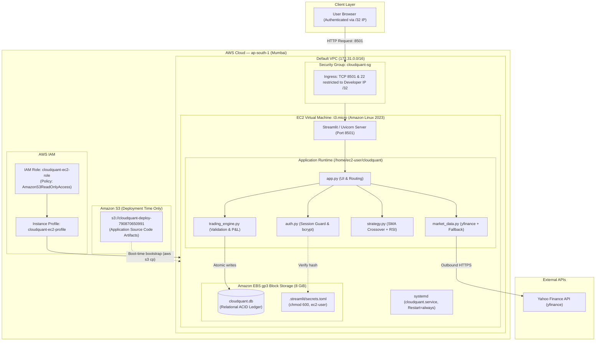
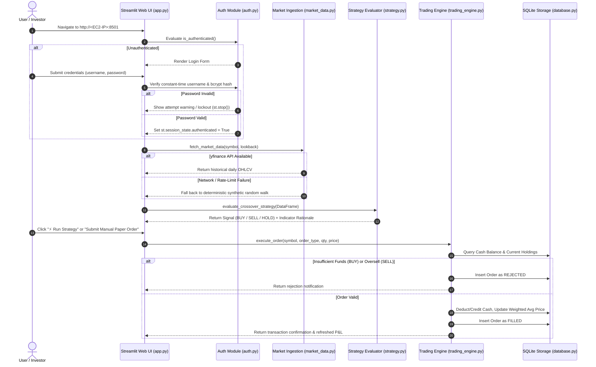

# CloudQuant: Cloud-Based Algorithmic Trading & Portfolio Management System

[-FF9900?logo=amazonec2&logoColor=white)](https://aws.amazon.com/ec2/)
[](https://www.python.org/)
[](https://streamlit.io/)
[](https://www.sqlite.org/)
[-00599C)](https://github.com/pyca/bcrypt/)
[](tests/)

> **Academic Coursework Project**: FT-III Cloud Computing  
> **Author**: K. Vishal Kumar (Reg. No: RA2311003011187, Section T-1)  
> **Institution**: SRM Institute of Science and Technology, Chennai  

CloudQuant is an educational, cloud-hosted **paper-trading simulator and algorithmic investment management platform** deployed on Amazon Web Services (AWS EC2). It eliminates reliance on local workstations by executing continuous market monitoring, technical indicator calculations, algorithmic signal generation, and simulated order book updates in the cloud with strict risk controls and persistent relational storage.

---

## 📌 Table of Contents

- [Problem Statement & Motivation](#-problem-statement--motivation)
- [System Architecture](#-system-architecture)
- [Core Application Workflow](#-core-application-workflow)
- [Algorithmic Trading & Risk Engine](#-algorithmic-trading--risk-engine)
- [Cloud Infrastructure & AWS Services](#-cloud-infrastructure--aws-services)
- [Security & Authentication Architecture](#-security--authentication-architecture)
- [Database Schema & Ledger Integrity](#-database-schema--ledger-integrity)
- [Local Installation & Quickstart](#-local-installation--quickstart)
- [Verification & Automated Test Suite](#-verification--automated-test-suite)
- [Cloud Deployment & Operations Guide](#-cloud-deployment--operations-guide)
- [Technical Trade-offs & Limitations](#-technical-trade-offs--limitations)
- [License](#-license)

---

## 🎯 Problem Statement & Motivation

1. **Manual Market Monitoring Fatigue**: Continuous manual observation of intraday and daily price swings across multiple financial equities is inefficient and vulnerable to emotional bias.
2. **Local Execution Vulnerability**: Running quantitative scripts on a local personal computer depends on workstation power, operating system sleep settings, and unstable residential broadband connections.
3. **Decoupled Records & Execution Risk**: Disconnected market charts, disparate spreadsheets, and unrecorded trades produce fragmented tracking and inconsistent investment decisions.
4. **Lack of Enforced Risk Controls**: Manual portfolio management often fails to enforce strict capital availability checks, oversell guards, and duplicate signal throttling.

**CloudQuant Solution**: A centralized, cloud-hosted dashboard running 24/7 on AWS EC2 that ingests market data, generates rule-based technical signals (SMA + RSI), verifies risk constraints, executes simulated orders, and maintains atomic transaction ledgers.

---

## 🏛 System Architecture

The deployed architecture isolates deployment-time bootstrapping from runtime service execution:



---

## 🔄 Core Application Workflow



---

## 📈 Algorithmic Trading & Risk Engine

CloudQuant implements a deterministic, explainable dual technical indicator strategy combined with capital risk controls:

### 1. Simple Moving Average (SMA) Crossover
Smooths price action over rolling trading sessions to identify momentum shifts:
- **Fast SMA (10-day)**: $\text{SMA}_{10}(t) = \frac{1}{10}\sum_{i=0}^{9} P_{t-i}$ (short-term momentum)
- **Slow SMA (30-day)**: $\text{SMA}_{30}(t) = \frac{1}{30}\sum_{i=0}^{29} P_{t-i}$ (trend baseline)

### 2. Relative Strength Index (RSI Filter)
Wilder's 14-day momentum oscillator bounded between $0$ and $100$:
$$\text{RSI} = 100 - \left( \frac{100}{1 + \frac{\text{AvgGain}_{14}}{\text{AvgLoss}_{14}}} \right)$$

### 3. Decision Matrix (`strategy.py`)
| Condition | Indicator State | Generated Signal | Explainability Rationale |
| :--- | :--- | :---: | :--- |
| **Bullish Trend / Cross** | $\text{SMA}_{10} > \text{SMA}_{30}$ and $\text{RSI} < 65$ | **BUY** | Upward price momentum confirmed without extreme overbought risk. |
| **Bearish Trend / Cross** | $\text{SMA}_{10} < \text{SMA}_{30}$ and $\text{RSI} > 35$ | **SELL** | Downward momentum confirmed without extreme oversold exhaustion. |
| **Overbought Exhaustion** | $\text{SMA}_{10} > \text{SMA}_{30}$ and $\text{RSI} \ge 65$ | **HOLD** | Bullish momentum present, but high overbought risk discourages new entry. |
| **Oversold Rebound** | $\text{SMA}_{10} < \text{SMA}_{30}$ and $\text{RSI} \le 35$ | **HOLD** | Bearish momentum present, but extreme oversold conditions advise waiting. |

### 4. Capital Accounting & Risk Checks (`trading_engine.py`)
- **Cash Availability Guard**: Prevents capital deficit. Rejects orders if $(\text{Qty} \times \text{Price}) > \text{Cash Balance}$.
- **Oversell Prevention**: Prohibits naked short-selling. Rejects SELL orders exceeding held quantity.
- **Weighted Average Cost Basis**: Dynamically recalculates cost basis upon partial additions:
  $$\bar{P}_{\text{new}} = \frac{(Q_{\text{held}} \times \bar{P}_{\text{held}}) + (Q_{\text{new}} \times P_{\text{buy}})}{Q_{\text{held}} + Q_{\text{new}}}$$
- **Duplicate Execution Throttling**: Checks recent executions in `strategy_runs`. Bypasses orders if identical signal direction occurred at a price within $\pm ₹0.01$.

---

## ☁️ Cloud Infrastructure & AWS Services

| AWS Resource | Implementation Details | Architectural Justification |
| :--- | :--- | :--- |
| **Amazon EC2** | `t3.micro` (2 vCPUs, 1.0 GiB RAM, Amazon Linux 2023) | **IaaS Compute**: Hosts the persistent Streamlit server and WebSocket daemon 24/7. |
| **Amazon EBS** | 8 GiB `gp3` (3,000 baseline IOPS, 125 MiB/s throughput) | **Block Storage**: Provides native POSIX filesystem byte-range locking required by SQLite transactions. |
| **Amazon S3** | `cloudquant-deploy-790870650991` (Private bucket) | **Deployment Store**: Overcomes the AWS EC2 25.6 KB user-data parameter limit by serving build artifacts during bootstrap. |
| **AWS IAM** | Role: `cloudquant-ec2-role`, Profile: `cloudquant-ec2-profile` | **Least Privilege**: Attaches `AmazonS3ReadOnlyAccess`. EC2 fetches STS tokens via IMDSv2 without static keys on disk. |
| **Security Group** | `cloudquant-sg` (`sg-06f6597a9c583daa2`) | **Stateful Firewall**: Strictly restricts inbound TCP 8501 (App) & 22 (SSH) to developer's `/32` IP CIDR. |
| **Amazon VPC** | Default VPC (`vpc-077c932ddad2b334e`, CIDR `172.31.0.0/16`) | **Networking**: Provides routing through an attached AWS Internet Gateway (IGW) for public reachability. |

---

## 🔒 Security & Authentication Architecture

1. **Fail-Closed Access Guard**: The authentication barrier executes at the entry point of `app.py`. If `.streamlit/secrets.toml` is absent or malformed, the application defaults to denying access and terminates execution via `st.stop()`.
2. **bcrypt Password Hashing (Cost Factor 12)**:
   - Uses an adaptive Key Derivation Function (KDF) based on the Blowfish cipher.
   - Cost factor 12 enforces $2^{12} = 4,096$ iterations of key expansion (~300ms compute per check), neutralizing GPU-accelerated brute-force and dictionary attacks.
   - Embeds a cryptographically secure 128-bit random salt, defeating Rainbow Table attacks.
3. **Constant-Time Timing Attack Mitigation**: Usernames are validated via `hmac.compare_digest(username.strip(), expected_username)`, preventing sub-microsecond timing discrepancies.
4. **Session-Scoped Brute-Force Lockout**: Tracks failed attempts within the active session. If 5 consecutive failures occur, the session is locked for 60 seconds (`LOCKOUT_SECONDS = 60`).
5. **Strict File Permissions**: The credential file `.streamlit/secrets.toml` is provisioned with POSIX octal mode `0600` (`-rw-------`), accessible strictly by `ec2-user`.

---

## 🗄 Database Schema & Ledger Integrity

SQLite schema initialized safely via `database.py`:

```sql
-- Single-row portfolio balance and accounting state
CREATE TABLE IF NOT EXISTS portfolio_state (
    id INTEGER PRIMARY KEY CHECK (id = 1),
    starting_capital REAL NOT NULL,
    cash_balance REAL NOT NULL,
    realized_pnl REAL NOT NULL DEFAULT 0.0,
    updated_at TEXT NOT NULL
);

-- Open equity holdings
CREATE TABLE IF NOT EXISTS holdings (
    symbol TEXT PRIMARY KEY,
    quantity INTEGER NOT NULL,
    average_buy_price REAL NOT NULL,
    updated_at TEXT NOT NULL
);

-- Complete immutable order history
CREATE TABLE IF NOT EXISTS orders (
    id INTEGER PRIMARY KEY AUTOINCREMENT,
    symbol TEXT NOT NULL,
    order_type TEXT NOT NULL,      -- 'BUY' or 'SELL'
    order_source TEXT NOT NULL,    -- 'MANUAL' or 'STRATEGY'
    quantity INTEGER NOT NULL,
    price REAL NOT NULL,
    total_value REAL NOT NULL,
    status TEXT NOT NULL,          -- 'FILLED' or 'REJECTED'
    reason TEXT,
    created_at TEXT NOT NULL
);

-- Audit log of technical strategy signals
CREATE TABLE IF NOT EXISTS strategy_runs (
    id INTEGER PRIMARY KEY AUTOINCREMENT,
    symbol TEXT NOT NULL,
    signal TEXT NOT NULL,          -- 'BUY', 'SELL', 'HOLD'
    fast_ma REAL,
    slow_ma REAL,
    rsi REAL,
    close_price REAL NOT NULL,
    rationale TEXT NOT NULL,
    executed_order_id INTEGER,
    created_at TEXT NOT NULL,
    FOREIGN KEY (executed_order_id) REFERENCES orders (id)
);
```

---

## 💻 Local Installation & Quickstart

### Prerequisites
- Python 3.10+ (tested on Python 3.11 and 3.13)
- `pip` package manager

### Setup Steps
```bash
# 1. Clone repository
git clone https://github.com/vixkumar/CloudQuant.git
cd CloudQuant

# 2. Create and activate a virtual environment
python3 -m venv .venv
source .venv/bin/activate

# 3. Install dependencies
pip install --upgrade pip
pip install -r requirements.txt

# 4. Initialize credentials
# Run the interactive setup script to generate .streamlit/secrets.toml
python3 setup_auth.py

# 5. Run the automated test suite
pytest -v

# 6. Launch the Streamlit dashboard locally
streamlit run app.py
```
Open **`http://localhost:8501`** in your browser.

---

## 🧪 Verification & Automated Test Suite

CloudQuant maintains comprehensive automated test coverage across financial ledger math, risk boundary conditions, and cryptographic authentication:

```bash
pytest test_trading_engine.py test_auth.py -v
```

### Verified Test Results (30/30 Passing)
```
============================= test session starts ==============================
collected 30 items

test_trading_engine.py::test_database_initialization PASSED              [  3%]
test_trading_engine.py::test_valid_buy_order PASSED                      [  6%]
test_trading_engine.py::test_insufficient_funds_rejection PASSED         [ 10%]
test_trading_engine.py::test_oversell_rejection PASSED                   [ 13%]
test_trading_engine.py::test_valid_sell_and_realized_pnl PASSED          [ 16%]
test_trading_engine.py::test_invalid_order_inputs PASSED                 [ 20%]
test_trading_engine.py::test_strategy_and_duplicate_prevention PASSED    [ 23%]
test_trading_engine.py::test_offline_sample_data_and_indicators PASSED   [ 26%]
test_trading_engine.py::test_fetch_market_data_fallback PASSED           [ 30%]
test_trading_engine.py::test_database_reset PASSED                       [ 33%]
test_auth.py::TestVerifyPassword::test_correct_password_returns_true PASSED [ 36%]
test_auth.py::TestVerifyPassword::test_wrong_password_returns_false PASSED [ 40%]
test_auth.py::TestVerifyPassword::test_empty_plain_returns_false PASSED  [ 43%]
test_auth.py::TestVerifyPassword::test_empty_hash_returns_false PASSED   [ 46%]
test_auth.py::TestVerifyPassword::test_both_empty_returns_false PASSED   [ 50%]
test_auth.py::TestVerifyPassword::test_case_sensitive PASSED             [ 53%]
test_auth.py::TestVerifyPassword::test_different_hashes_same_password PASSED [ 56%]
test_auth.py::TestVerifyPassword::test_malformed_hash_returns_false PASSED [ 60%]
test_auth.py::TestVerifyPassword::test_none_like_inputs PASSED           [ 63%]
test_auth.py::TestIsAuthenticated::test_unauthenticated_by_default PASSED [ 66%]
test_auth.py::TestIsAuthenticated::test_authenticated_when_flag_set PASSED [ 70%]
test_auth.py::TestIsAuthenticated::test_authenticated_false_when_explicitly_false PASSED [ 73%]
test_auth.py::TestLogout::test_logout_clears_authenticated PASSED        [ 76%]
test_auth.py::TestLogout::test_logout_clears_all_auth_keys PASSED        [ 80%]
test_auth.py::TestLogout::test_logout_safe_when_already_logged_out PASSED [ 83%]
test_auth.py::TestTradingEngineIntegrity::test_buy_order_succeeds PASSED [ 86%]
test_auth.py::TestTradingEngineIntegrity::test_insufficient_funds_still_rejected PASSED [ 90%]
test_auth.py::TestTradingEngineIntegrity::test_oversell_still_rejected PASSED [ 93%]
test_auth.py::TestTradingEngineIntegrity::test_realized_pnl_calculation PASSED [ 96%]
test_auth.py::TestTradingEngineIntegrity::test_duplicate_strategy_signal_blocked PASSED [100%]

======================= 30 passed, 33 warnings in 4.28s ========================
```

---

## 🚀 Cloud Deployment & Operations Guide

### 1. Provision Infrastructure via AWS CLI
```bash
# Set region and profile
export AWS_REGION="ap-south-1"
export AWS_PROFILE="vixk"

# 1. Create Security Group restricted to current IP
MY_IP=$(curl -s https://checkip.amazonaws.com)
SG_ID=$(aws ec2 create-security-group \
  --group-name cloudquant-sg \
  --description "CloudQuant Restricted Access" \
  --query "GroupId" --output text)

aws ec2 authorize-security-group-ingress --group-id "$SG_ID" --protocol tcp --port 8501 --cidr "${MY_IP}/32"
aws ec2 authorize-security-group-ingress --group-id "$SG_ID" --protocol tcp --port 22 --cidr "${MY_IP}/32"

# 2. Upload source code to Amazon S3
aws s3 mb "s3://cloudquant-deploy-<YOUR_ACCOUNT_ID>"
aws s3 cp app.py "s3://cloudquant-deploy-<YOUR_ACCOUNT_ID>/app.py"
aws s3 cp auth.py "s3://cloudquant-deploy-<YOUR_ACCOUNT_ID>/auth.py"
aws s3 cp database.py "s3://cloudquant-deploy-<YOUR_ACCOUNT_ID>/database.py"
aws s3 cp market_data.py "s3://cloudquant-deploy-<YOUR_ACCOUNT_ID>/market_data.py"
aws s3 cp strategy.py "s3://cloudquant-deploy-<YOUR_ACCOUNT_ID>/strategy.py"
aws s3 cp trading_engine.py "s3://cloudquant-deploy-<YOUR_ACCOUNT_ID>/trading_engine.py"
aws s3 cp requirements.txt "s3://cloudquant-deploy-<YOUR_ACCOUNT_ID>/requirements.txt"

# 3. Launch EC2 instance with attached IAM Profile and slim bootstrap
aws ec2 run-instances \
  --image-id resolve:ssm:/aws/service/ami-amazon-linux-latest/al2023-ami-kernel-default-x86_64 \
  --instance-type t3.micro \
  --security-group-ids "$SG_ID" \
  --iam-instance-profile Name=cloudquant-ec2-profile \
  --block-device-mappings '[{"DeviceName":"/dev/xvda","Ebs":{"VolumeSize":8,"VolumeType":"gp3","DeleteOnTermination":true}}]' \
  --user-data file://deploy/ec2_user_data_slim.sh
```

### 2. Service Management Commands (on EC2)
```bash
# Check service health
sudo systemctl status cloudquant.service

# View real-time application logs
sudo journalctl -u cloudquant.service -f

# Check listening ports
ss -tulpn | grep 8501

# Safely stop instance to pause compute billing
aws ec2 stop-instances --instance-ids <INSTANCE_ID>

# Start instance when needed
aws ec2 start-instances --instance-ids <INSTANCE_ID>
```

---

## ⚠️ Technical Trade-offs & Limitations

1. **Single Availability Zone (Single Point of Failure)**: Deployed in a single AZ (`ap-south-1a/b`). If a data center hardware failure occurs, the application is unavailable until AWS recovers the instance or volume.
2. **Transport Layer Encryption (HTTP vs HTTPS)**: The service operates over cleartext HTTP on port 8501. Packets (including login submissions) are unencrypted in transit. Securing with TLS via AWS Certificate Manager (ACM) and an Application Load Balancer (ALB) or Nginx reverse proxy is targeted for future scope.
3. **Concurrency Bottlenecks with SQLite**: SQLite locks the database file during writes (`database is locked`). Under high concurrent user order volumes, a distributed database like Amazon RDS PostgreSQL with connection pooling would be required.
4. **Session-Level Brute-Force Lockout**: Failed login attempt counters reside in Streamlit's `st.session_state`. Clearing browser cookies resets the counter. Enterprise hardening would use an external cache (Redis) or IP-based rate limiting via AWS WAF.
5. **User-Triggered vs Scheduled Execution**: Strategy evaluations run upon user interaction; automated event-driven cron scheduling via AWS EventBridge or systemd timers remains a documented roadmap item.

---

## 📜 License

This project is developed solely for educational and academic evaluation purposes under the **FT-III Cloud Computing** curriculum at SRM Institute of Science and Technology. Distributed under the [MIT License](LICENSE).
