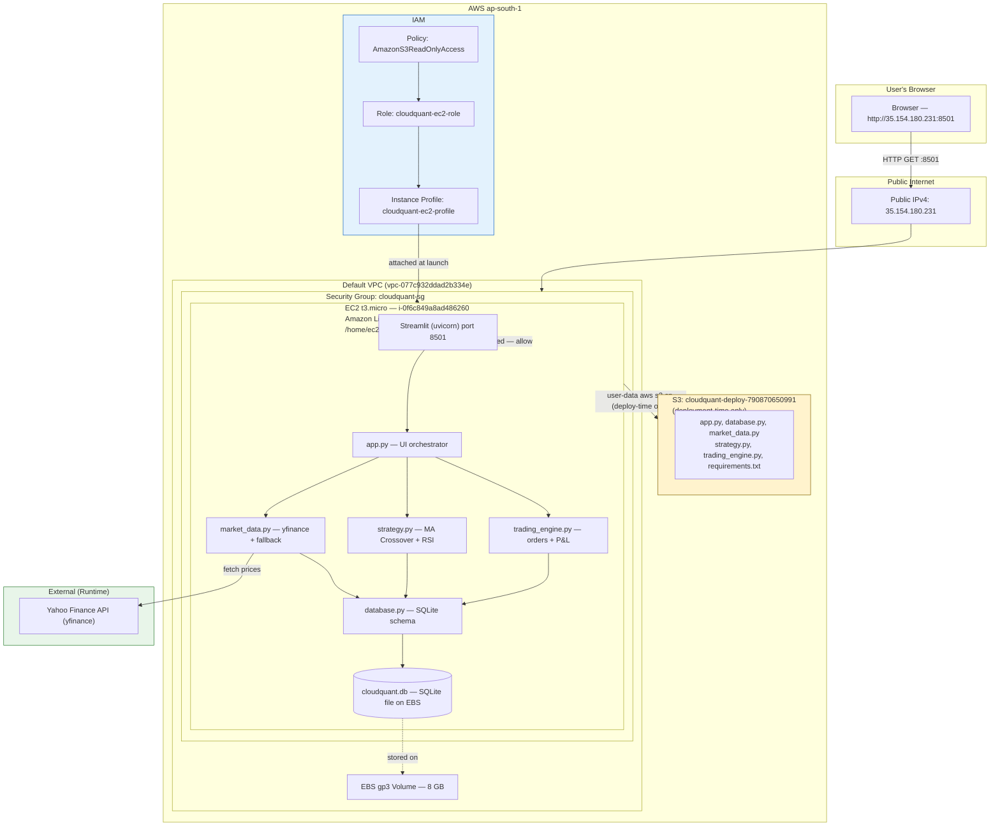

# CloudQuant — Complete Viva Preparation Guide

> **Source of truth:** Every detail in this guide is sourced from actual project files and verified live AWS configuration. Nothing is invented.

---

## 1. Project Overview

### What is CloudQuant?

CloudQuant is a **cloud-hosted, paper-trading simulation application** built as a college coursework project for FT-III Cloud Computing. It lets a user:

- Watch live (or sample) Indian equity price charts
- See automated BUY/SELL/HOLD signals from a rule-based algorithm
- Execute simulated (paper) trades with no real money
- Track a virtual portfolio with P&L, holdings, and order history — all persisted in a database

**Paper trading** = practicing trading with fake money. No broker, no real transactions.

---

### Problem Statement

| Problem | How CloudQuant Solves It |
|---------|--------------------------|
| Manual monitoring of markets is exhausting | Dashboard auto-fetches prices and computes signals |
| Local scripts depend on your laptop being on | App runs 24/7 on AWS EC2 in the cloud |
| Inconsistent decisions from emotion or missed data | Rule-based strategy removes subjectivity |
| No systematic portfolio tracking | SQLite database persists every order, holding, and P&L change |

---

### Core Features (Verified in Code)

1. **Market Data Fetching** — Live data via `yfinance` for 4 NSE stocks; graceful fallback to deterministic synthetic data if network fails
2. **Technical Indicators** — SMA(10), SMA(30), RSI(14) computed on every page load
3. **Algorithmic Trading Signal** — MA Crossover + RSI filter → BUY / SELL / HOLD
4. **Strategy Execution** — Click a button → engine executes the signal as a paper order
5. **Manual Paper Trading** — User can also place manual BUY/SELL orders at will
6. **Risk Controls** — Cash check, oversell prevention, duplicate signal rejection
7. **Portfolio Dashboard** — Available cash, portfolio value, unrealized P&L, realized P&L, trade count
8. **Audit Ledger** — Full order history with FILLED/REJECTED status
9. **Offline Safe Mode** — Force sample data for demos without internet
10. **Account Reset** — Wipe all data and restart with new capital amount

---

### Supported Equities (from `market_data.py`)

| Symbol | Company |
|--------|---------|
| `RELIANCE.NS` | Reliance Industries |
| `TCS.NS` | Tata Consultancy Services |
| `INFY.NS` | Infosys |
| `HDFCBANK.NS` | HDFC Bank |

---

### Trading Strategy: Moving Average Crossover + RSI Filter

**Three indicators (from `market_data.py` → `calculate_indicators`):**

- **SMA Fast (10-day):** Average of last 10 closing prices. Reacts quickly to price changes.
- **SMA Slow (30-day):** Average of last 30 closing prices. Represents longer trend.
- **RSI (14-day):** Relative Strength Index — measures momentum on a 0–100 scale. >70 = overbought, <30 = oversold.

**Signal rules (from `strategy.py` lines 40–57):**

```
BUY  → Fast SMA > Slow SMA  AND  RSI < 65   (bullish trend, not overbought)
SELL → Fast SMA < Slow SMA  AND  RSI > 35   (bearish trend, not oversold)
HOLD → Neither condition met
```

---

### Paper-Trading Logic (from `trading_engine.py`)

**BUY:** Validate → check cash → deduct → update holdings (weighted avg price) → log FILLED order

**SELL:** Validate → check held qty → credit cash → compute realized PnL → update/delete holding → log FILLED order

**Weighted average price:** `new_avg = ((held_qty × old_avg) + total_cost) / new_qty`

---

### Risk Controls (Verified in Code)

| Control | Location | What It Does |
|---------|----------|--------------|
| Cash check | `execute_order()` line 117 | Rejects BUY if cost > cash balance |
| Oversell guard | `execute_order()` line 156 | Rejects SELL if qty > held shares |
| Duplicate signal prevention | `run_strategy_signal()` line 226 | Skips if same signal + price within ₹0.01 |
| Input validation | `execute_order()` lines 90–97 | Rejects zero/negative qty/price, invalid type |
| REJECTED orders logged | lines 119–122, 158–161 | Every rejection permanently recorded |

---

### Limitations

1. No scheduled execution — strategy only runs on manual click
2. SQLite not PostgreSQL — single-file DB, not concurrent-safe
3. No HTTPS — plain HTTP port 8501
4. No CloudWatch monitoring or alerting
5. Single EC2 instance, single AZ — no redundancy
6. Historical daily prices — not real-time ticks
7. No real broker integration

---

## 2. Architecture Diagram



> **Key distinctions:**
> - S3 is deploy-time only — EC2 downloads files once at boot, then never touches S3 again
> - IAM role/profile enabled the `aws s3 cp` in user-data — the Streamlit app itself makes no AWS API calls at runtime
> - yfinance makes outbound calls to Yahoo Finance — works because default VPC allows all egress

---

## 3. AWS Services Used

### Amazon EC2
Virtual machine (t3.micro, Amazon Linux 2023, ap-south-1). Hosts the persistent Streamlit server. Chosen because Lambda can't run persistent WebSocket servers. **Cost: ~$0.0116/hr. t3.micro is NOT Free Tier eligible; t2.micro would be.**

### Amazon S3
Object storage bucket (`cloudquant-deploy-790870650991`). Used only at deployment time — source files are too large (46KB) for user-data (25KB limit). Downloaded once at EC2 boot via `aws s3 cp`. **Cost: negligible (<1MB).**

### IAM (Role + Instance Profile + Policy)
- `cloudquant-ec2-role` — trust: `ec2.amazonaws.com`
- `cloudquant-ec2-profile` — instance profile wrapping the role
- `AmazonS3ReadOnlyAccess` — only permission granted
- No hardcoded credentials anywhere. EC2 gets temp creds from IMDS automatically.

### Security Group (`cloudquant-sg`)
Stateful firewall. Inbound: TCP 22 + 8501 from `49.37.215.96/32` only. Outbound: all allowed (default). `/32` = exactly one IP.

### EBS (8GB gp3)
Root volume attached to EC2. Stores OS, Python packages, app files, and `cloudquant.db`. Deleted on termination (`DeleteOnTermination=true`).

### Default VPC
Pre-existing VPC with internet gateway. No custom networking created.

---

## 4. Deployment — Step by Step

Every step below was actually executed.

1. **AWS CLI auth:** `aws login --profile vixk` → account `790870650991` (root), region `ap-south-1`

2. **S3 upload:** Created bucket, uploaded 6 Python files + requirements.txt to work around 25KB user-data limit

3. **IAM role:** Created role with EC2 trust, attached `AmazonS3ReadOnlyAccess`, created instance profile, linked role

4. **Security group:** Created `cloudquant-sg` with inbound TCP 22+8501 from detected public IP

5. **AMI lookup:** `aws ssm get-parameter /aws/service/ami-amazon-linux-latest/al2023-ami-kernel-default-x86_64` → `ami-022374b883d9d7931`

6. **EC2 launch:** `aws ec2 run-instances` with t3.micro, AMI, SG, instance profile, 8GB gp3 EBS, user-data file → `i-0f6c849a8ad486260`

7. **cloud-init (user-data) runs at first boot (as root, ~70 seconds):**
   ```
   dnf update -y
   dnf install -y python3.11 python3.11-pip
   mkdir /home/ec2-user/cloudquant
   aws s3 cp s3://cloudquant-deploy-790870650991/*.py .  (uses IAM role)
   pip install -r requirements.txt
   write /etc/systemd/system/cloudquant.service
   chown -R ec2-user:ec2-user /home/ec2-user/cloudquant   ← CRITICAL
   systemctl enable && start cloudquant
   ```

8. **Fix applied:** Initial deploy forgot `chown`. Files owned by root; service runs as `ec2-user` → `sqlite3.OperationalError`. Fixed via EC2 Instance Connect (temp SSH key push, no stored key pair). Now baked into user-data.

9. **Verified:** `curl http://35.154.180.231:8501` → HTTP 200, `server: uvicorn` in headers

---

## 5. Code Walkthrough

### Module Map
```
app.py
  ├── database.py       → init_db, reset_db, DEFAULT_DB_PATH
  ├── market_data.py    → SUPPORTED_SYMBOLS, fetch_market_data
  ├── strategy.py       → evaluate_crossover_strategy
  └── trading_engine.py → TradingEngine
       └── database.py  → get_connection, DEFAULT_DB_PATH
```

### `database.py`
- `get_connection()`: SQLite connection with `row_factory=sqlite3.Row` (column-name access) + `PRAGMA foreign_keys = ON`
- `init_db()`: Creates 4 tables IF NOT EXISTS (idempotent), seeds `portfolio_state` with ₹1,00,000 if empty
- `reset_db()`: Deletes all rows, re-seeds capital
- DB path: `os.path.dirname(__file__)/cloudquant.db` = `/home/ec2-user/cloudquant/cloudquant.db`

### `market_data.py`
- `fetch_market_data(symbol, period, force_sample)`: Try yfinance → if <15 rows or exception → synthetic fallback
- `generate_sample_data()`: Deterministic (seeded by `hash(symbol)`) synthetic prices using normal-distributed returns
- `calculate_indicators()`: SMA via `.rolling().mean()`, RSI via gain/loss rolling averages

### `strategy.py`
- Pure function, no DB access, no side effects
- Reads latest 2 rows of DataFrame, checks crossover conditions
- Returns dict: `{symbol, signal, fast_ma, slow_ma, rsi, close_price, rationale}`

### `trading_engine.py`
- Class `TradingEngine(db_path)` — connection-per-operation pattern
- `get_portfolio_summary()`: Reads state + holdings, computes unrealized P&L
- `execute_order()`: Atomic transaction (`with conn:`), validates, checks cash/qty, updates 3 tables
- `run_strategy_signal()`: Duplicate check → execute_order → always log to strategy_runs
- SELL uses `min(default_qty, held)` to avoid oversell attempt

### `app.py`
- `init_db()` + `TradingEngine()` at top (every page load)
- Sidebar: symbol selector, period selector, offline checkbox, account reset expander
- Main: fetch data → 5 metrics → 3 tabs (chart, strategy, manual trade) → holdings + orders table
- `st.rerun()` after successful orders to refresh metrics

### `test_trading_engine.py`
9 tests using `pytest` fixture with isolated temp SQLite DB:
DB init, valid BUY, insufficient funds, oversell, realized P&L, invalid inputs, duplicate prevention, sample data, fetch fallback

---

## 6. Cloud Concepts — Viva Ready

| Concept | Project Application |
|---------|---------------------|
| **IaaS** | EC2: we manage OS, Python runtime, systemd, app — AWS manages hardware + hypervisor |
| **PaaS** | S3 is managed storage (no server to run) — borderline PaaS |
| **SaaS** | Yahoo Finance / yfinance API — we consume it as a service |
| **Virtualization** | EC2 runs on AWS Nitro hypervisor — our VM shares physical hardware with others |
| **Region/AZ** | ap-south-1 (Mumbai); single AZ deployment — no HA |
| **VPC/subnet** | Default VPC with built-in internet gateway — no custom networking |
| **Public IP** | `35.154.180.231` — ephemeral, changes on stop/start |
| **Security group** | Stateful firewall — tracks connection state, auto-allows responses |
| **IAM least privilege** | S3ReadOnly only; no hardcoded keys; temp creds via IMDS |
| **Instance profile** | EC2 can't directly assume a role — needs instance profile wrapper |
| **Object vs block storage** | S3=HTTP API for whole files; EBS=filesystem for byte-level access |
| **User data / cloud-init** | Runs once at first boot as root; automating all provisioning |
| **Availability** | `Restart=always` in systemd; single point of failure otherwise |
| **Scalability** | Not designed for scale — single instance, SQLite doesn't support concurrent writes |
| **Cost management** | t3.micro ~$8.50/month; t2.micro Free Tier eligible; always terminate when done |

---

## 7. Security and Costs

| Area | Status | Notes |
|------|--------|-------|
| Inbound ports | ✅ Restricted | Ports 22+8501 from single IP only |
| IAM | ✅ Least privilege | S3ReadOnly; no hardcoded creds |
| No stored key pair | ✅ | EC2 Instance Connect for emergency access |
| HTTPS | ⚠️ Missing | Plain HTTP — no TLS |
| Auth | ⚠️ Missing | No login required |
| Data persistence | ⚠️ EBS only | Deleted on instance termination |
| t3.micro cost | ⚠️ ~$8.50/month | NOT Free Tier. t2.micro would be Free Tier eligible |
| Cost Explorer | ⚠️ Not enabled | Can't confirm actual charges via API yet |

---

## 8. Verification and Troubleshooting

### Deployment Tested By:
- `aws ec2 wait instance-running` → confirmed running state
- `curl -w "%{http_code}" http://35.154.180.231:8501` → **200**
- `curl -sv http://35.154.180.231:8501` → `server: uvicorn` confirmed
- EC2 console output → cloud-init finished in 70 seconds

### Check Service Status (SSH in):
```bash
sudo systemctl status cloudquant
sudo journalctl -u cloudquant -f
cat /var/log/cloudquant-install.log
ss -tlnp | grep 8501
```

### Common Failures:
| Error | Cause | Fix |
|-------|-------|-----|
| `sqlite3.OperationalError: unable to open database file` | Files root-owned, service runs as ec2-user | `sudo chown -R ec2-user:ec2-user /home/ec2-user/cloudquant` |
| Connection refused on 8501 | Service not running | `sudo systemctl restart cloudquant` |
| `Encoded User data is limited to 25600 bytes` | Script too large | Upload to S3, minimal user-data |
| Browser can't connect | Your IP changed | Update security group inbound rule |
| `Your session has expired` | AWS CLI credentials expired | `aws login --profile vixk` |

---

## 9. Viva Q&A — 25 Questions

**Q1: What problem does CloudQuant solve?**
Manual stock monitoring is time-consuming and emotionally inconsistent. CloudQuant hosts a rule-based algorithm on AWS EC2 that auto-generates BUY/SELL/HOLD signals, executes paper trades, and persists portfolio state — accessible from any browser, 24/7, without a local computer.

**Q2: Why EC2 instead of Lambda?**
Streamlit requires a persistent server that maintains WebSocket connections. Lambda terminates after each invocation and cannot host persistent server processes.

**Q3: What is the data flow when a user opens the app?**
Browser → Public IP → Security Group (IP check) → Streamlit (uvicorn) → app.py runs top-to-bottom → `fetch_market_data()` (yfinance) → `get_portfolio_summary()` (SQLite) → rendered HTML/JS sent back to browser.

**Q4: Why is S3 in your architecture but not used at runtime?**
S3 works around the 25,600-byte user-data limit. Source files (46KB) are too large to embed. EC2 downloads them from S3 at first boot using the IAM role, after which all files are on local EBS. S3 is a deployment artifact store, not a runtime dependency.

**Q5: Describe the database schema.**
4 tables: `portfolio_state` (1 row: cash, starting capital, realized PnL), `holdings` (one row per open position with avg price), `orders` (every order: FILLED+REJECTED, append-only), `strategy_runs` (every signal run, FK → orders).

**Q6: What is IaaS vs PaaS vs SaaS? Where does this project fit?**
IaaS = raw compute (EC2, you manage OS+runtime). PaaS = managed platform (Elastic Beanstalk, RDS). SaaS = ready-to-use software (Gmail). This project is primarily **IaaS** — we manage Python, systemd, everything above the hypervisor.

**Q7: What is an IAM role and why use one instead of access keys?**
A role defines permissions that AWS services can assume. The EC2 instance gets temporary credentials automatically from the Instance Metadata Service (169.254.169.254) — no hardcoded keys anywhere. Hardcoded keys in scripts are a security risk (exposed in logs, git history).

**Q8: What is an instance profile?**
EC2 can't directly assume an IAM role — it needs an instance profile as a container/wrapper. Mapping: `EC2 → Instance Profile → IAM Role → Policies`.

**Q9: What is a security group and how is it stateful?**
A virtual firewall controlling EC2 traffic. Stateful = tracks connection state, so outbound request responses are auto-allowed inbound without explicit rules. Our group: port 22+8501 from one IP only; all outbound allowed.

**Q10: Why restrict to /32 instead of 0.0.0.0/0?**
`/32` = exactly one IP. `0.0.0.0/0` = public. Since there's no authentication on the app, restricting to our IP prevents anyone else from accessing or manipulating the portfolio. Least privilege applied to networking.

**Q11: EBS vs S3 difference?**
EBS = block storage (mounted filesystem, low-latency, byte-level access, tied to one AZ). S3 = object storage (HTTP API, store/retrieve whole files, globally durable, not mounted). EBS for database; S3 for deployment file storage.

**Q12: What is user data / cloud-init?**
User data = script passed to EC2 at launch (max 25,600 bytes). cloud-init = Linux service that executes it once at first boot as root. Logs at `/var/log/cloudquant-install.log`. Finished in 70 seconds on our instance.

**Q13: Why did you get the 25,600-byte error and how did you fix it?**
Original script embedded all Python files as base64 = 46KB. Fix: upload files to S3, use a 1.5KB user-data script that downloads them via `aws s3 cp` using the IAM role.

**Q14: Why the sqlite3.OperationalError and how was it fixed?**
User-data runs as root → files owned root. Service runs as ec2-user → can't write `cloudquant.db` in a root-owned directory. Fix: `sudo chown -R ec2-user:ec2-user /home/ec2-user/cloudquant`. Now baked into user-data.

**Q15: How did you SSH in without a key pair?**
EC2 Instance Connect: `aws ec2-instance-connect send-ssh-public-key` pushes a temp public key for 60 seconds. Port 22 was already open to our IP. No stored key pair needed.

**Q16: Why t3.micro and not t2.micro?**
Script defaulted to t3.micro. In retrospect, t2.micro is better: it's **Free Tier eligible** (750 hours/month) while t3.micro is not. Both are burstable. For this prototype, t2.micro has sufficient resources.

**Q17: Explain the MA Crossover strategy.**
Fast SMA (10-day) reacts quickly to price changes; Slow SMA (30-day) tracks long-term trend. When Fast crosses above Slow → recent momentum outpacing long-term → BUY signal. When Fast crosses below Slow → bearish → SELL. RSI filter prevents buying when overbought or selling when oversold.

**Q18: What is RSI and why use it as a filter?**
Relative Strength Index (0–100) measures momentum via ratio of average gains to average losses over 14 days. RSI>70 = overbought (may correct soon); RSI<30 = oversold (may bounce). Used as a secondary filter to avoid entering at extremes. Our thresholds: 65/35 (tighter than classic 70/30 for extra safety).

**Q19: How does duplicate signal prevention work?**
Reads the last `strategy_runs` row for the symbol. If same signal direction AND price within ₹0.01 → `is_duplicate=True` → skip execution, just log. Prevents repeated orders on every page reload when market is flat.

**Q20: How is realized P&L calculated?**
`proceeds = qty_sold × sell_price`. `cost_basis = qty_sold × avg_buy_price`. `realized_pnl = proceeds − cost_basis`. Unrealized P&L = `(current_price − avg_buy_price) × qty_held` (for shares still held).

**Q21: Is this secure enough for production?**
No: plain HTTP (no TLS), no user authentication, single IP allowlisting breaks if IP changes, SQLite not concurrent-safe, no secrets manager, single AZ. For production: ALB + ACM (HTTPS), Cognito (auth), RDS PostgreSQL, Secrets Manager, Multi-AZ.

**Q22: What is the actual deployment cost?**
t3.micro: ~$0.0116/hr = ~$8.50/month. EBS 8GB gp3: ~$0.08/month. S3: negligible. t3.micro is NOT Free Tier. Cost Explorer wasn't enabled at deploy time — exact billing not confirmable via API. Always terminate when done.

**Q23: What happens if EC2 is terminated?**
EBS volume deleted (`DeleteOnTermination=true`) → `cloudquant.db` permanently lost → all portfolio history gone. S3 bucket still exists with source code. Relaunch recreates a fresh empty portfolio. Mitigation: EBS snapshots or store data on a separate persistent EBS volume.

**Q24: Why SQLite and not PostgreSQL?**
Cost. RDS PostgreSQL costs ~$15/month. SQLite = zero cost, bundled with Python. Satisfies the same ACID requirements for a single-user prototype. The PPT promised PostgreSQL/RDS — SQLite was a cost-driven substitution. Code change to migrate: swap `sqlite3` for `psycopg2` and change connection strings.

**Q25: How would you redesign for production?**
Auto Scaling Group of t2.micro behind ALB (HA + scaling). RDS PostgreSQL Multi-AZ (concurrent-safe, automated backups, failover). ACM certificate on ALB (HTTPS). Cognito (authentication). CloudWatch (monitoring + alarms). EventBridge (scheduled strategy execution). CodePipeline + CodeDeploy (CI/CD). Reserved Instances for cost savings.

---

## Cleanup Commands

```bash
# Terminate EC2 (stops billing immediately)
aws ec2 terminate-instances --profile vixk --region ap-south-1 --instance-ids i-0f6c849a8ad486260

# Wait, then delete security group
aws ec2 wait instance-terminated --profile vixk --region ap-south-1 --instance-ids i-0f6c849a8ad486260
aws ec2 delete-security-group --profile vixk --region ap-south-1 --group-id sg-06f6597a9c583daa2

# Empty and delete S3 bucket
aws s3 rb s3://cloudquant-deploy-790870650991 --force --profile vixk --region ap-south-1

# Remove IAM (order matters)
aws iam remove-role-from-instance-profile --profile vixk --instance-profile-name cloudquant-ec2-profile --role-name cloudquant-ec2-role
aws iam delete-instance-profile --profile vixk --instance-profile-name cloudquant-ec2-profile
aws iam detach-role-policy --profile vixk --role-name cloudquant-ec2-role --policy-arn arn:aws:iam::aws:policy/AmazonS3ReadOnlyAccess
aws iam delete-role --profile vixk --role-name cloudquant-ec2-role
```

---

*Guide generated from actual project source files and verified live AWS configuration — October 2026.*

