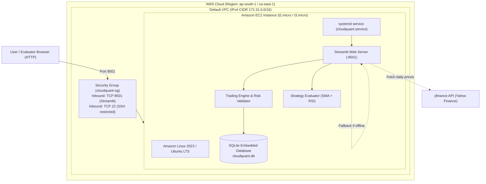

# System Architecture — CloudQuant

## Overview

CloudQuant is architected to satisfy college coursework criteria (FT-III Cloud Computing) with maximum reliability and absolute minimal cost ($0.00 spend on AWS).

## High-Level Architecture Diagram

## Architectural Design Decisions

1. **Monolithic Compute vs Container Orchestration:** 
   - A single EC2 micro instance hosting Streamlit and SQLite avoids the overhead and steep costs of Amazon EKS, ECS, or Application Load Balancers ($18–$40/mo).
2. **Local Embedded SQLite vs Amazon RDS:**
   - SQLite satisfies ACID properties for a single-user simulation without incurring managed database charges ($15+/mo for db.t3.micro).
3. **Stateless Fallback (Offline Mode):**
   - External dependencies (yfinance) can rate-limit or fail during an academic viva. A deterministic mathematical generator provides instant fallback with zero external calls.
