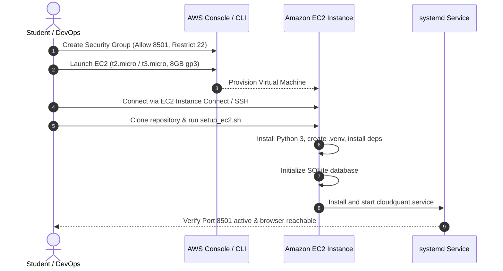

# Deployment Runbook — CloudQuant

This document details the exact sequence for deploying CloudQuant to AWS EC2 under the Free Tier.

## Deployment Flow Diagram



## Step-by-Step EC2 Deployment Guide

### Step 1: Security Group Creation
Create a security group `cloudquant-sg` in default VPC:
- Inbound Rule 1: Custom TCP, Port `8501`, Source `0.0.0.0/0` (or `My IP` for restricted viva demo).
- Inbound Rule 2: SSH TCP, Port `22`, Source `My IP` (never `0.0.0.0/0`).

### Step 2: EC2 Instance Launch
- **AMI:** Amazon Linux 2023 AMI (Free Tier eligible).
- **Instance Type:** `t2.micro` (or `t3.micro` in regions where t2 is unavailable).
- **Key Pair:** Create or select an existing `.pem` key pair (or use EC2 Instance Connect).
- **Network Settings:** Enable "Auto-assign public IP". Select `cloudquant-sg`.
- **Storage:** 8 GB gp3 (well within 30 GB free tier).

### Step 3: Application Setup
Connect to the instance via browser (EC2 Instance Connect) and run:
```bash
git clone https://github.com/<your-username>/cloudquant.git
cd cloudquant
chmod +x deploy/setup_ec2.sh
./deploy/setup_ec2.sh
```

### Step 4: Verification
Access `http://<EC2_PUBLIC_IP>:8501` in your browser. Verify the dashboard and database state.
